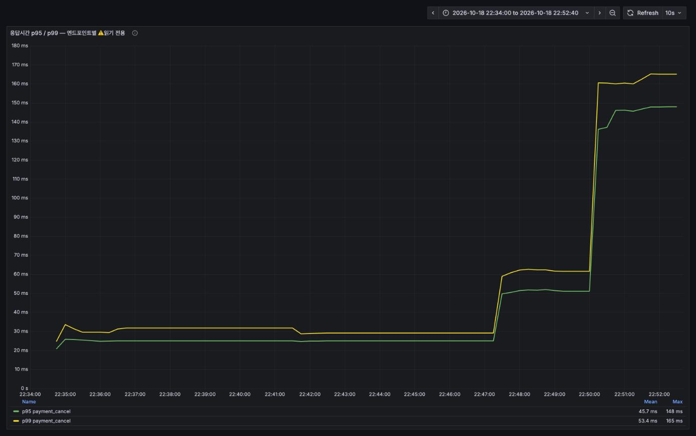
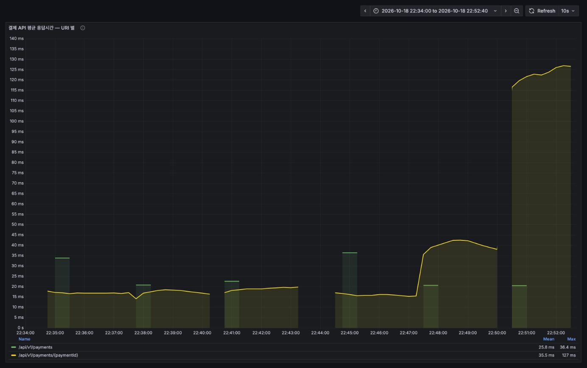
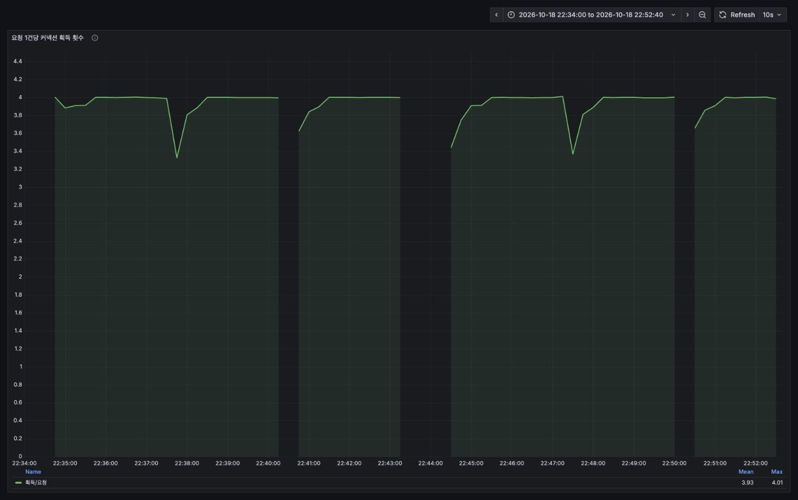

# 지원 거절 벌크 UPDATE 전후 비교 보고서

측정일 2026-10-18 22:33–22:56 · 대상 `DELETE /api/v1/payments/{paymentId}` (결제 취소)
도구 k6 v2.3.0 + Prometheus + Grafana

> [`REPORT-2026-10-18-grafana.md`](REPORT-2026-10-18-grafana.md) 의 **권고 ①**
> ("`rejectApplication` 을 벌크 UPDATE 로")이 적용되어, 그 효과를 A/B 로 측정했습니다.

---

## 1. 요약

| 공고당 지원자 | 이전 (루프) | 이후 (벌크) | 개선 |
|---|---|---|---|
| 0명 | avg **18.01ms** / p95 24.82ms | avg **18.94ms** / p95 26.33ms | 차이 없음 (오차) |
| 50명 | avg **42.59ms** / p95 53.76ms | avg **20.01ms** / p95 24.14ms | **2.1배** |
| 200명 | avg **123.80ms** / p95 147.94ms | avg **20.91ms** / p95 26.18ms | **5.9배** |

**지원자 1명당 비용이 사라졌습니다.**

| | 지원자 1명당 증가 (avg) |
|---|---|
| 이전 | **+0.53ms** |
| 이후 | **+0.01ms** |

의도한 결과가 그대로 나왔습니다 — **응답시간이 지원자 수와 무관한 상수**가 됐고,
커넥션 획득 횟수는 4.0회로 변하지 않았습니다(구조를 건드리지 않았다는 뜻).

> ⚠️ 1차 측정에서는 벌크 UPDATE 가 JPA 감사(`@LastModifiedDate`)를 우회해
> **거절된 지원의 `updated_at` 이 갱신되지 않는 회귀**가 있었습니다.
> **그 자리에서 수정되어 재검증까지 끝났습니다** ([5절](#5-회귀-updated_at-이-갱신되지-않는다--수정-완료)).

---

## 2. 무엇이 바뀌었나

```java
// 이전 — 지원자 1명당 UPDATE 1개
@Transactional
public void rejectApplication(Post post) {
    applicationRepository.findAllByPostAndStatus(post, ApplicationStatus.PENDING)
            .forEach(Application::reject);
}

// 이후 — 쿼리 1개
@Transactional
public void rejectApplication(Post post) {
    applicationRepository.rejectAllByPostAndStatusPending(post);
}
```

```java
// ApplicationRepository — A/B 측정 시점 버전
@Modifying
@Query("update Application a set " +
        "a.status=ApplicationStatus.REJECTED, a.activePostId=null " +
        "where a.post=:post and a.status=ApplicationStatus.PENDING")
int rejectAllByPostAndStatusPending(@Param("post") Post post);
```

> 이 쿼리는 측정 뒤 `updated_at` 회귀를 고치면서 한 번 더 바뀌었습니다
> ([5절](#5-회귀-updated_at-이-갱신되지-않는다--수정-완료)). **아래 A/B 수치는 위 버전으로 잰 것**이고,
> 최종 버전도 성능은 동일함을 따로 확인했습니다.

`Application.reject()` 는 `status=REJECTED` 로 바꾼 뒤 `syncActivePostId()` 로
`activePostId` 를 `null` 로 만듭니다(REJECTED 는 활성 상태가 아니므로). 벌크 쿼리가 그 두 값을
직접 세팅하므로 **상태 전이 자체는 동등**합니다. 이전 보고서가 권고하며 단서로 달았던
"`active_post_id = NULL` 도 같이 세팅해야 한다"가 지켜졌습니다.

---

## 3. 측정 방법

**같은 작업 트리에서 빌드한 두 jar 를 번갈아 띄워** 쟀습니다. `rejectApplication` **하나만** 다릅니다.

| | 내용 |
|---|---|
| after.jar | 현재 작업 트리 그대로 빌드 |
| before.jar | 작업 트리를 임시 디렉터리로 복사한 뒤 **그 복사본에서만** `rejectApplication` 을 루프 방식으로 되돌려 빌드. **작업 트리는 건드리지 않았습니다.** |

두 jar 는 `application-dev.yaml`(`hikari.connection-timeout: 3000` 포함), 스케줄러 설정,
의존성이 모두 같습니다. 변수는 하나뿐입니다.

| 항목 | 값 |
|---|---|
| 시나리오 | `loadtest/payment/cancel.js` — `-e STAGE=load -e RATE=20 -e DURATION=2m` (2,401건 취소) |
| 지원자 수 | 0 / 50 / 200 (`seed-applications.sql` 의 `@applicants`) |
| 시드 | `[LT-PAY-D]` 공고 3,000건 + DONE 결제 3,000건 (취소 2,401건에 넉넉) |
| 지원 행 수 | 0 / 150,000 / 600,000 |
| 측정 순서 | after 3회 → 서버 교체 → before 3회. 각 서버 기동 후 30초 워밍업 1회 |
| 매 측정 전 | `teardown.sql` → `seed.sql` → (`seed-applications.sql`) 로 **완전히 새 시드** |
| 환경 | 포트 8080, profile `dev`, `ddl-auto=update` 로 덮어씀, SQL 로깅 off, Hikari 풀 기본값 10 |
| k6 지표 | Prometheus remote-write, `--system-tags` 에서 `url,name` 제외 |

> `--system-tags` 를 줄였으므로 이번 측정에서는 **k6 쪽 백분위수 패널도 신뢰할 수 있습니다**
> (평소 쓰기 테스트에서 시리즈가 쪼개지던 문제가 없습니다 — [공통 README](../../README.md#️-계측-함정-세-가지)).

---

## 4. 결과

### 4-1. 클라이언트가 본 응답시간

| run | avg | med | p90 | p95 | p99 | max | 실패율 |
|---|---|---|---|---|---|---|---|
| **after** 0명 | 18.94ms | 17.78ms | 23.50ms | 26.33ms | 85.36ms | 91.55ms | 0% |
| **after** 50명 | 20.01ms | 19.28ms | 22.30ms | 24.14ms | 84.14ms | 117.39ms | 0% |
| **after** 200명 | 20.91ms | 19.61ms | 23.96ms | 26.18ms | 84.43ms | 87.76ms | 0% |
| **before** 0명 | 18.01ms | 16.68ms | 22.46ms | 24.82ms | 84.81ms | 91.50ms | 0% |
| **before** 50명 | 42.59ms | 43.00ms | 49.74ms | 53.76ms | 84.02ms | 105.04ms | 0% |
| **before** 200명 | 123.80ms | 123.53ms | 142.06ms | 147.94ms | 165.09ms | 195.39ms | 0% |

여섯 번 모두 20.3 req/s 를 유지했고 실패는 0건이었습니다.



*왼쪽 절반(22:34–22:43)이 **이후**, 오른쪽 절반(22:44–22:52)이 **이전**입니다.
이후 구간은 지원자가 0 → 50 → 200 으로 늘어도 **평평**하고, 이전 구간은 22:47 과 22:50 에
두 번 계단을 밟습니다.*

### 4-2. 서버가 본 응답시간

`http_server_requests_seconds` (네트워크 제외, 취소 URI 만).

| 공고당 지원자 | 이전 | 이후 |
|---|---|---|
| 0명 | 16.0ms | 16.9ms |
| 50명 | **41.7ms** | **18.0ms** |
| 200명 | **124.6ms** | **19.2ms** |



*노란 선이 `DELETE /api/v1/payments/{paymentId}` 입니다. 이후 3회(앞쪽)는 17~19ms 에 붙어 있고,
이전 3회(뒤쪽)는 16ms → 40ms → 125ms 로 올라갑니다. 초록 막대는 setup 의 목록 조회입니다.*

클라이언트 수치와 서버 수치가 거의 같습니다 — **네트워크나 큐가 아니라 서버 처리시간 자체가 줄었습니다.**

### 4-3. 커넥션 사용 패턴

| 공고당 지원자 | 요청당 획득 (이전/이후) | 점유시간 max (이전/이후) | active max (이전/이후) |
|---|---|---|---|
| 0명 | 4.00 / 4.00 | 0.117s / 0.113s | 1 / 1 |
| 50명 | 4.00 / 4.00 | 0.100s / 0.109s | 1 / 1 |
| 200명 | 4.00 / 4.00 | **0.180s / 0.081s** | 3 / 0 |



*여섯 구간 전부 4.0 입니다. 중간의 하락은 측정 사이 유휴 구간의 분모 흔들림입니다.*

**이게 이번 변경의 성격을 정확히 보여줍니다.** 커넥션을 **더 적게 잡는 게 아니라 더 짧게 잡습니다.**
이전 보고서가 짚었던 그대로입니다 —

> 커넥션 획득 횟수가 늘지 않은 것은 이 루프가 한 트랜잭션 안에서 돌기 때문입니다.
> 즉 커넥션을 더 쓰는 게 아니라 **커넥션을 더 오래 붙잡습니다.**

200명 구간에서 점유시간이 0.18초 → 0.081초로 줄었고, 동시 active 도 3 → 0~1 로 내려왔습니다.
풀이 10인 상황에서 **인기 공고가 몰려 취소될 때의 위험이 실제로 낮아졌습니다.**

### 4-4. 기울기

avg 기준 지원자 1명당 비용입니다.

| 구간 | 이전 | 이후 |
|---|---|---|
| 0 → 50명 | +0.492 ms/명 | +0.021 ms/명 |
| 0 → 200명 | +0.529 ms/명 | **+0.010 ms/명** |

이전 측정(`REPORT.md` 3-5)의 **+0.48~0.58 ms/명** 과 일치합니다 — **이전 동작이 그대로 재현됐습니다.**
이후는 기울기가 약 **50배** 완만해졌고, 남은 0.01ms/명 은 측정 오차와 구분되지 않습니다.

> **0명 구간에서 이후가 0.9ms 느립니다**(18.01 → 18.94ms). 서버 측에서도 같은 방향으로
> 0.9ms 차이가 납니다. 실행 간 변동 범위이고, 지원자가 한 명이라도 생기는 순간 뒤집힙니다.
> 확정하려면 각 조건을 여러 번 반복해 분산을 봐야 합니다.

### 4-5. 기능 동등성

측정 직후 DB 에서 확인했습니다.

| 측정 | REJECTED 행 | PENDING 잔여 | **REJECTED 인데 active_post_id 가 남은 행** |
|---|---|---|---|
| after 50명 | 120,050 | 29,950 | **0** |
| after 200명 | 480,200 | 119,800 | **0** |
| before 50명 | 120,000 | 30,000 | **0** |
| before 200명 | 480,000 | 120,000 | **0** |

취소한 공고(약 2,401건)의 PENDING 지원이 전부 REJECTED 로 바뀌었고, `active_post_id` 는
양쪽 모두 `NULL` 로 정리됐습니다. **남은 PENDING 은 취소하지 않은 공고의 것**입니다
(3,000개 공고 중 2,401개만 취소).

---

## 5. 회귀: `updated_at` 이 갱신되지 않는다 ⚠️ → 수정 완료

**벌크 UPDATE 는 JPA 엔티티 리스너를 타지 않습니다.** `Application` 은 `BaseTimeEntity` 를 상속하고,
`updated_at` 은 `@LastModifiedDate` + `AuditingEntityListener` 로 관리됩니다. 영속성 컨텍스트를
거치지 않는 벌크 쿼리는 그 리스너를 호출하지 않으므로 **`updated_at` 이 그대로 남습니다.**

실측으로 확인했습니다. PENDING 지원의 `updated_at` 을 `2020-01-01` 로 밀어 두고 취소를 한 번 실행한 뒤,
REJECTED 로 바뀐 행의 `updated_at` 을 봤습니다.

| | 취소 전 | 취소 후 (REJECTED 3건) |
|---|---|---|
| **이전 (루프)** | 2020-01-01 | **2026-10-18 22:56** ✅ 갱신됨 |
| **이후 (벌크)** | 2020-01-01 | **2020-01-01** ❌ **갱신 안 됨** |

상태는 바뀌었는데 "언제 바뀌었는지"는 사라집니다. 지원 이력 화면, 정렬, 데이터 분석, 감사 추적에서
문제가 될 수 있습니다.

### 적용된 수정 (검증 완료)

```java
// ApplicationRepository
@Modifying(clearAutomatically = true, flushAutomatically = true)
@Query("update Application a set " +
        "a.status=ApplicationStatus.REJECTED, a.activePostId=null, a.updatedAt=:now " +
        "where a.post=:post and a.status=ApplicationStatus.PENDING")
int rejectAllByPost(@Param("post") Post post,
                    @Param("now") LocalDateTime now);

// PaymentPersistenceService
@Transactional
public void rejectApplication(Post post) {
    applicationRepository.rejectAllByPost(post, LocalDateTime.now());
}
```

`updatedAt` 은 `BaseTimeEntity` 의 `private` 필드이지만 **JPQL 은 필드명으로 접근하므로 그대로 동작합니다.**

이 버전으로 jar 를 빌드해 재검증했습니다.

| 확인 항목 | 결과 |
|---|---|
| 컴파일·기동 (HQL 파싱·검증은 부팅 때 일어난다) | ✅ 성공 |
| 스모크 12종 | ✅ 전부 통과 |
| `updated_at` 갱신 | ✅ `2020-01-01` → **`2026-10-18 23:21:34.670074`** (현재시각 `23:21:35.009`) |
| `active_post_id` 잔여 | ✅ 0건 |
| 지원자 200명 × 2,401건 취소 후 | ✅ REJECTED 480,000건 / `leaked_active` 0 / **`stale_updated_at` 0** |
| 성능 유지 | ✅ avg **17.40ms** / p95 **19.40ms** (루프판 123.80 / 147.94ms) |

**감사 필드를 되살리면서 성능 이득은 그대로**입니다 — 시각을 파라미터로 바인딩할 뿐이라
지원자 수와 무관한 상수입니다.

#### 왜 `now()` 가 아니라 파라미터인가

처음 적용된 안은 HQL `now()` 였고 동작은 했지만 **초 단위로 끊겼습니다**
(`23:13:42.000000` — MySQL `NOW()` 가 기본 0 자리인데 컬럼은 `datetime(6)`).
파라미터로 `LocalDateTime.now()` 를 넘기면 **마이크로초까지 보존**되어
엔티티 리스너가 채우던 값과 정밀도가 같아집니다. 실측 비교:

| 방식 | 저장된 값 |
|---|---|
| `a.updatedAt=now()` | `2026-10-18 23:13:42.000000` |
| `a.updatedAt=:now` (적용된 안) | `2026-10-18 23:21:34.670074` |

테스트에서 시각을 고정할 수 있다는 이점도 따라옵니다.

### 남은 메모

**`clearAutomatically = true` 는 지금은 안전하지만 조건부입니다.** 이 옵션은 벌크 UPDATE 뒤
**영속성 컨텍스트 전체를 비웁니다.** 지금은 `PaymentService.cancel` 에 `@Transactional` 이 없어
`rejectApplication` 이 자기 트랜잭션·자기 컨텍스트에서 돌기 때문에 영향이 없습니다.

하지만 **나중에 `cancel` 을 `@Transactional` 로 묶으면** 컨텍스트를 공유하게 되고, clear 가
호출부가 들고 있던 엔티티까지 준영속으로 만듭니다. 바로 다음 줄이 이겁니다.

```java
paymentPersistenceService.rejectApplication(post);   // ← 여기서 컨텍스트가 비워진다
noticeService.send(post.getClient(),                 // ← 미초기화 프록시면 LazyInitializationException
        C_PAYMENT_CANCELED.of(post.getTitle(), ...), ...);
```

옵션이 틀렸다는 게 아니라 **"상위를 트랜잭션으로 묶을 때 같이 봐야 할 자리"** 라는 뜻입니다.
`flushAutomatically = true` 는 같은 이유로 지금은 할 일이 없지만, 그때 필요해집니다.

---

## 6. 그 밖에 확인한 것 / 남은 것

### 측정하지 않은 것

- **지원자 500명·1,000명 구간.** 이후는 상수여야 하므로 더 늘려도 같을 것으로 보이지만 재지 않았습니다.
- **반복 측정.** 각 조건을 1회씩만 쟀습니다. 2배·5.9배 같은 큰 차이는 명확하지만,
  0명 구간의 0.9ms 차이는 반복 없이는 판단할 수 없습니다.
- **외부 결제 API 지연.** `INIT-PAYKEY-` 우회로 토스 호출이 0ms 입니다. 실제 지연이 들어가면
  전체 응답시간이 올라가고, **이 개선의 상대적 비중은 줄어듭니다**(절대 이득은 그대로).
- **`clearAutomatically` 가 실제로 문제를 일으키는 조건.** 상위를 `@Transactional` 로 묶은
  상태는 재보지 않았습니다 ([5절](#남은-메모)).

---

## 7. 재현 방법

```bash
cd /Users/admin/DevCProject
set -a && . ./.env && set +a

# 1) 두 버전의 jar 준비
./gradlew bootJar -x test            # 현재(이후) 버전
cp build/libs/NBE-12-14-2-Team06-0.0.1.jar /tmp/after.jar

#    이전 버전은 작업 트리를 복사한 뒤 그 복사본에서만 되돌려 빌드한다
#    (PaymentPersistenceService.rejectApplication 을 findAllByPostAndStatus(...).forEach(Application::reject) 로)

# 2) 각 jar 를 번갈아 띄우고 지원자 0 / 50 / 200 으로 3회씩
java -jar /tmp/after.jar --server.port=8080 --spring.profiles.active=dev \
  --spring.jpa.hibernate.ddl-auto=update \
  --logging.level.org.hibernate.SQL=WARN --logging.level.org.hibernate.orm.jdbc.bind=WARN

#    매 측정 전: teardown -> seed(@done_count=3000) -> seed-applications(@applicants=N)
docker exec -i escort-mysql mysql -uroot -p"$MYSQL_ROOT_PASSWORD" escort < loadtest/payment/sql/teardown.sql
docker exec -i escort-mysql mysql -uroot -p"$MYSQL_ROOT_PASSWORD" escort < loadtest/payment/sql/seed.sql
docker exec -i escort-mysql mysql -uroot -p"$MYSQL_ROOT_PASSWORD" escort < loadtest/payment/sql/seed-applications.sql

export K6_PROMETHEUS_RW_SERVER_URL=http://localhost:9090/api/v1/write
export K6_PROMETHEUS_RW_TREND_STATS='p(95),p(99),max'
k6 run -o experimental-prometheus-rw --tag run=after-200applicants \
  --system-tags 'proto,status,method,group,check,error,error_code,scenario,expected_response' \
  -e STAGE=load -e RATE=20 -e DURATION=2m loadtest/payment/cancel.js

# 3) 기능 동등성 확인
docker exec -i escort-mysql mysql -uroot -p"$MYSQL_ROOT_PASSWORD" escort -e "
  select sum(a.status='REJECTED') rejected,
         sum(a.status='PENDING')  pending,
         sum(a.status='REJECTED' and a.active_post_id is not null) leaked_active
  from application a join post p on p.id=a.post_id
  where p.title like '[LT-PAY-D]%';"

# 4) updated_at 감사 확인 (5절)
#    취소 전에 PENDING 행의 updated_at 을 과거로 밀어 두고, smoke 로 1건 취소한 뒤 다시 본다
docker exec -i escort-mysql mysql -uroot -p"$MYSQL_ROOT_PASSWORD" escort -e "
  update application set updated_at='2020-01-01 00:00:00' where status='PENDING';"
k6 run loadtest/payment/smoke.js
docker exec -i escort-mysql mysql -uroot -p"$MYSQL_ROOT_PASSWORD" escort -e "
  select status, count(*), min(updated_at), max(updated_at) from application group by status;"

# 5) 정리
docker exec -i escort-mysql mysql -uroot -p"$MYSQL_ROOT_PASSWORD" escort < loadtest/payment/sql/teardown.sql
```

Grafana: <http://localhost:3001> → GAJI 폴더 → **결제 도메인 부하테스트 (k6 + Hikari)**
(`uid: payment-loadtest`), 구간 22:34–22:52.

---

## 8. 측정 후 DB 상태

`teardown.sql` 로 전부 정리하고 `BaseInitData` 초기 상태로 복구했습니다.

| 테이블 | 복구 후 |
|---|---|
| post | 16 |
| payment | 16 |
| application | 0 |
| users | 7 |
| 남은 시드 공고 | 0 |

> 측정 중 작업 트리의 소스는 **한 줄도 바꾸지 않았습니다.** 이전 버전은 임시 디렉터리에 복사한
> 사본에서만 되돌려 빌드했습니다.
