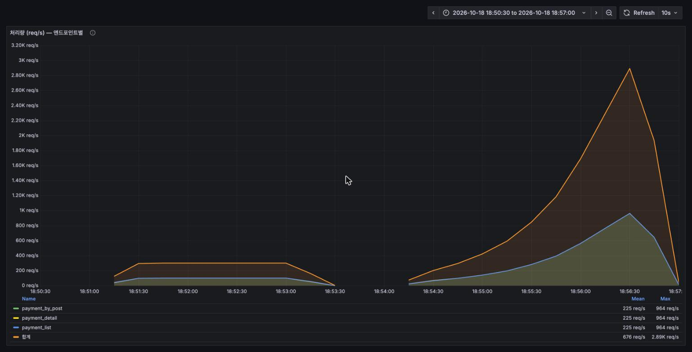
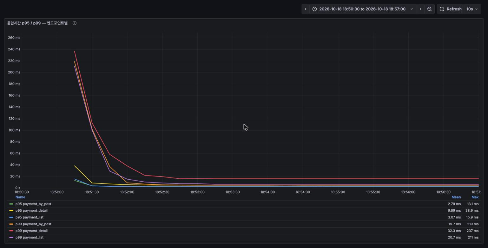
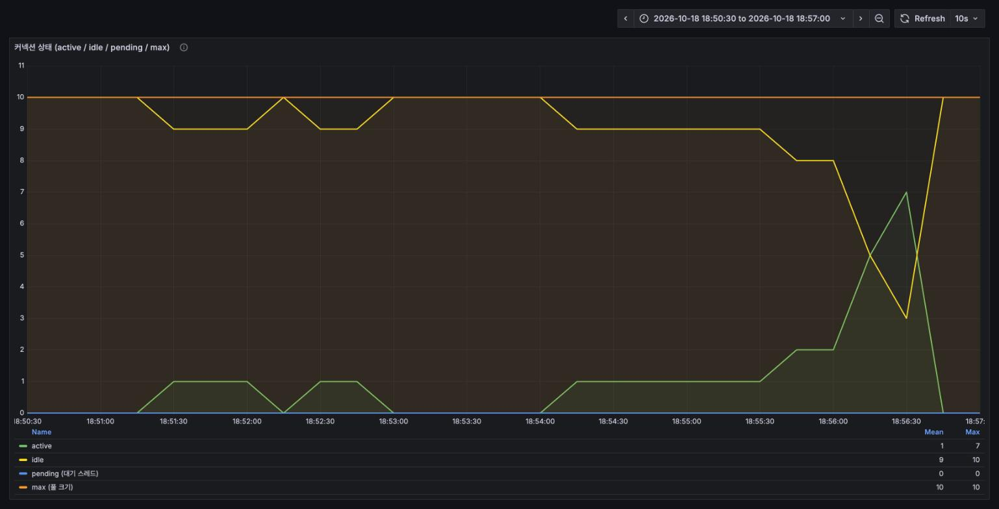
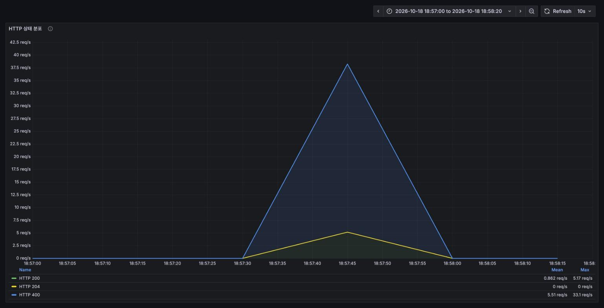
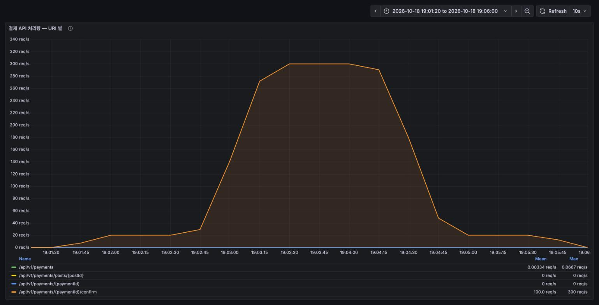
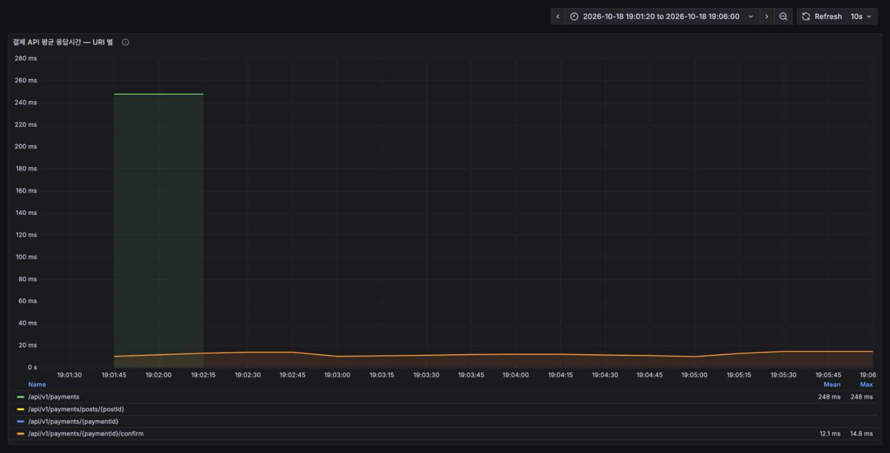
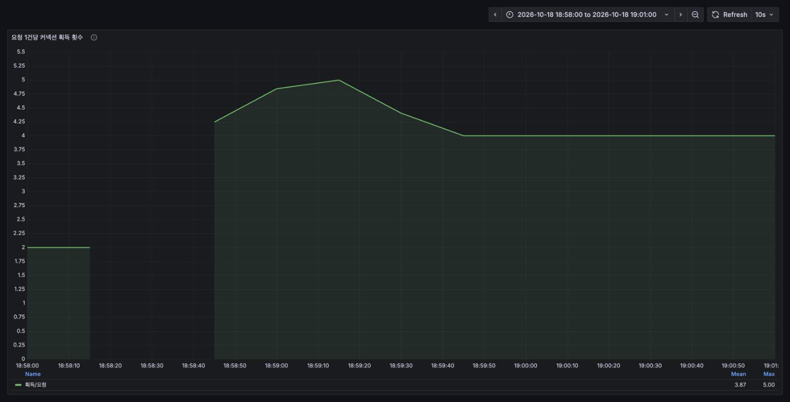
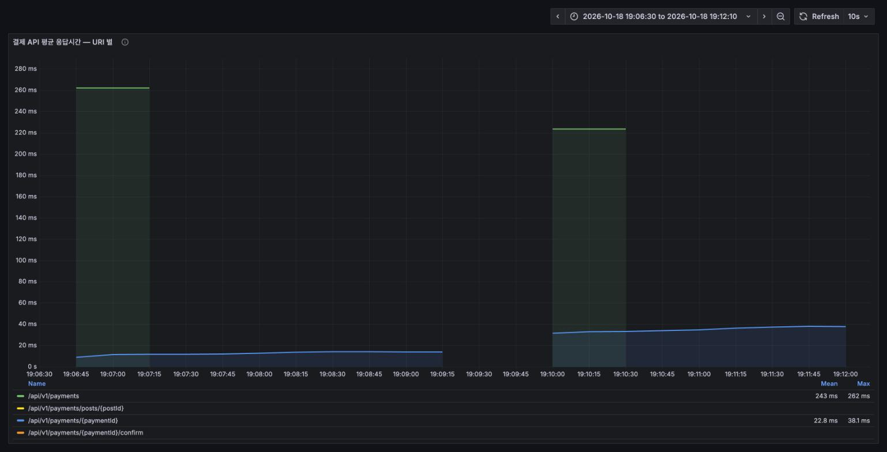
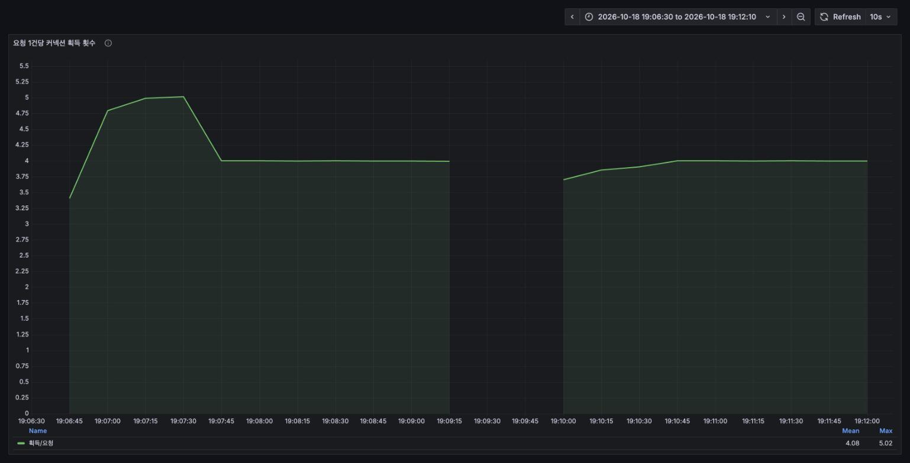

# 결제 도메인 부하테스트 보고서 (Grafana 계측판)

측정일 2026-10-18 19:00 전후 · 대상 `/api/v1/payments` 전 경로 · 도구 k6 v2.3.0 + Prometheus + Grafana

> **이 보고서를 따로 쓴 이유.** 같은 날 먼저 작성한 [`REPORT.md`](REPORT.md) 는 **8081 포트의 별도
> 인스턴스**에서 측정했는데, Prometheus 는 `BACKEND_PORT=8080` 만 스크랩합니다. 그래서 그 보고서의
> 수치에는 **대응하는 서버 지표가 Prometheus 에 전혀 없고, Grafana 로 보여줄 수가 없습니다.**
>
> 이번에는 **Prometheus 가 스크랩하는 8080 인스턴스에서 전 시나리오를 다시 측정**하고,
> k6 지표까지 remote-write 로 같은 Prometheus 에 밀어 넣어 **모든 수치에 Grafana 그림을 붙였습니다.**
> 아래 수치와 그림은 전부 같은 측정에서 나온 것입니다.

---

## 1. 요약

| 항목 | 결과 | 근거 |
|---|---|---|
| 읽기 처리량 | **피크 3,096 req/s**, 에러 0%, p99 5.24ms | [3-2](#3-2-읽기--한계점-탐색) |
| 읽기 병목 | **이번 측정에선 나타나지 않음.** 커넥션 풀 active 최대 7/10, pending 0 | [3-2](#3-2-읽기--한계점-탐색) |
| 결제 승인 | 300 req/s 급증을 전부 소화 (p95 17.9ms, 에러 0%) | [3-4](#3-4-결제-승인--급증-스파이크) |
| 결제 취소 | 20 req/s 에서 p95 19.2ms. **지원자 1명당 +0.44ms 선형 증가** | [3-5](#3-5-결제-취소--지원자-수에-따른-비용-) |
| 중복 결제 방어 | 동시 20건 × 50라운드 **완벽** (중복 승인 0건) | [3-3](#3-3-결제-승인--동시성-정합성-) |
| 치명적 결함 | 없음 | — |
| 구조적 비용 | **승인·취소 1건당 커넥션 4.0회 획득** (트랜잭션 경계 분리) | [3-4](#3-4-결제-승인--급증-스파이크) |

**이전 보고서와 달라진 가장 큰 점:** `REPORT.md` 가 지목했던 *"읽기 1,100 req/s 에서 커넥션 풀 포화,
획득 대기 4초"* 가 **이번 재측정에서 재현되지 않았습니다.** 같은 스크립트·같은 풀 크기(10)로
3배 가까운 처리량을 냈는데도 pending 은 내내 0 이었습니다. 자세한 분석은 [5절](#5-이전-보고서와-다른-결과가-나온-지점)에 있습니다.

---

## 2. 측정 환경

| 항목 | 값 |
|---|---|
| 애플리케이션 | `java -jar` (bootJar), **포트 8080**, profile `dev` |
| 기동 옵션 | `--spring.jpa.hibernate.ddl-auto=update` (시드 보호), SQL 로깅 `WARN`, `format_sql`/`highlight_sql`/`use_sql_comments=false` |
| JVM | Java 26, JIT 기본(C2 포함) |
| DB | MySQL 8.0 (Docker, 127.0.0.1:3307) |
| Hikari 풀 | **max 10** (설정에 없어 기본값) |
| 모니터링 | Prometheus v3.7.3 (15s 스크랩) + Grafana 12.2.0, `docker-compose.monitoring.yml` |
| k6 지표 | `-o experimental-prometheus-rw` 로 같은 Prometheus 에 remote-write, `--tag run=<시나리오>` |
| 부하 생성 | k6 v2.3.0, **동일 머신** (macOS / Apple Silicon) |
| 시드 | `client03` 에 공고:결제 1:1 — READY 32,000건 / DONE 7,000건 (`seed.sql`) |
| 워밍업 | 측정 전 `smoke.js` 1회 선행 |
| 대시보드 | `monitoring/grafana/dashboards/payment-loadtest.json` (이번에 신규 작성, 14개 패널) |

### 이번에 바꾼 것

- **측정 인스턴스를 8080 으로 옮겼습니다.** Prometheus 스크랩 대상과 일치시키기 위해서입니다.
  (`prometheus.yml` 의 타깃이 `host.docker.internal:${BACKEND_PORT:-8080}` 입니다.)
- **`ddl-auto` 를 커맨드라인에서 `update` 로 덮어썼습니다.** `application-dev.yaml` 은 `create` 라
  재기동할 때마다 시드가 날아가는데(`REPORT.md` 5절), 파일을 고치지 않고 런타임 플래그로 피했습니다.
- **Grafana 대시보드를 새로 만들었습니다.** 기존 `GAJI Backend Monitoring` 에는 Hikari 획득 대기·pending,
  요청당 커넥션 획득 횟수, k6 지표 패널이 없어 이 보고서의 핵심을 그림으로 보여줄 수 없었습니다.

### 시나리오 실행 순서와 시각

| 시나리오 | 구간 | 명령 |
|---|---|---|
| read-load | 18:50:59 – 18:53:00 | `-e STAGE=load -e RATE=100 -e DURATION=2m read.js` |
| read-stress | 18:54:00 – 18:56:30 | `-e STAGE=stress -e STAGE_DURATION=30s read.js` |
| confirm-race | 18:57:32 – 18:57:34 | `-e CONCURRENCY=20 -e ROUNDS=50 confirm-race.js` |
| confirm-load | 18:58:35 – 19:00:36 | `-e STAGE=load -e RATE=50 -e DURATION=2m confirm.js` |
| confirm-spike | 19:01:38 – 19:05:39 | `-e STAGE=spike confirm.js` |
| cancel (지원자 0명) | 19:06:41 – 19:08:42 | `-e STAGE=load -e RATE=20 -e DURATION=2m cancel.js` |
| cancel (지원자 50명) | 19:09:47 – 19:11:47 | 위와 동일, `seed-applications.sql @applicants=50` 선행 |

쓰기 시나리오 사이에는 매번 `reset.sql` 을 돌렸고(1~2초), 각 구간 사이에 60초 간격을 두어
Grafana 에서 구간이 겹치지 않게 했습니다.

---

## 3. 결과

### 3-1. 읽기 — 평균 부하 (100 iter/s = 300 req/s, 2분, `client01`)

| 엔드포인트 | p95 | p99 | 실패율 |
|---|---|---|---|
| `GET /payments` (목록) | 2.41ms | 6.67ms | 0% |
| `GET /payments/{id}` (상세) | 4.86ms | 12.35ms | 0% |
| `GET /payments/posts/{postId}` | 2.11ms | 3.84ms | 0% |

총 36,043 req / **300.07 req/s** / 체크 35,985건 전부 통과. 임계값 전원 통과.

> 상세(4.86ms)가 목록(2.41ms)보다 느린 건 `client01` 의 목록이 6건뿐이라 작고, 상세는 fetch join +
> 소유자 검증을 타기 때문입니다. **결제가 많은 계정에서는 역전됩니다** — [4-④](#-목록-조회가-결제-건수에-비례한다)를 보세요.

### 3-2. 읽기 — 한계점 탐색

50 → 100 → 200 → 400 → 800 → 1,200 iter/s 로 30초씩 올렸습니다 (1 iteration = 3 요청).

| 지표 | 값 |
|---|---|
| 달성 처리량 | 평균 1,274.6 req/s, **피크 3,096 req/s** (총 191,329 req) |
| 실패율 | **0%** |
| p95 / p99 / max | 3.83ms / **5.24ms** / 111.55ms |
| dropped_iterations | **0** (목표 도착률 전부 달성) |
| 사용 VU | 80 (preAllocated 80, maxVUs 800 — 더 필요 없었음) |
| Hikari active (max) | **7 / 10** |
| Hikari pending | **0** |
| Hikari 획득 대기 (max) | **16ms** |
| Hikari timeout | 0건 |



*평균 부하(18:51–18:53, 평평한 300 req/s)와 한계점 탐색(18:54–18:56:30, 계단식 상승) 두 구간.
마지막 단계에서 3,000 req/s 를 넘깁니다.*



*처음 1분의 200ms 대 봉우리는 **JIT 워밍업**입니다. 그 뒤로는 부하가 10배로 올라가는 내내
p95 가 한 자릿수 ms 에 붙어 있습니다.*



**해석.** 3,096 req/s 를 내는 순간에도 **active 가 7, pending 은 0** 입니다. 풀 크기 10 이 읽기 경로에서는
여유가 있습니다. `REPORT.md` 가 지목했던 풀 포화는 이번 측정에서 나타나지 않았습니다 ([5절](#5-이전-보고서와-다른-결과가-나온-지점)).

다만 **이 수치도 서버 상한은 아닙니다.** k6·서버·MySQL 이 같은 머신이라 피크에서 시스템 CPU 가 78% 까지
올라갔습니다 (JVM 프로세스 자체는 13.7%). 상한을 제대로 보려면 부하 생성기를 다른 머신으로 빼야 합니다.

### 3-3. 결제 승인 — 동시성 정합성 ⭐

같은 `paymentId` 에 **동시 20건**을 `http.batch` 로 때리고, 서로 다른 `paymentKey`/`orderId` 를 보내
방어선이 뚫리면 유니크 제약이 아니라 중복 승인으로 드러나게 했습니다. 50라운드 반복.

| 지표 | 결과 |
|---|---|
| 총 승인 시도 | 1,000건 (20 × 50) |
| 승인 성공 | **정확히 50건** (라운드당 1건) |
| 거절 | 950건 (전부 HTTP 400) |
| `duplicate_approvals` | **0** |
| 승인 후 상태 / 금액 | 전 라운드 `DONE` / 금액 무결 |



*서버가 본 HTTP 상태 분포. **400(거절)이 200(성공)을 압도**합니다 — 이게 정상이고, 방어선이
동작하고 있다는 뜻입니다. 200 쪽에는 라운드마다의 검증 조회도 섞여 있습니다.*

`PaymentRepository.paymentInProgress` 의 조건부 UPDATE (`WHERE id=? AND payment_status='READY'`)
가 CAS 로 정확히 동작합니다. **결제 도메인에서 가장 중요한 불변식이 동시성 하에서 유지됨을 확인했습니다.**

### 3-4. 결제 승인 — 급증(스파이크)

| 프로파일 | 처리량 | p95 | p99 | max | 실패율 |
|---|---|---|---|---|---|
| load (50 req/s, 2분) | 50.3 req/s (6,063건) | 13.93ms | 23.59ms | 295ms | 0% |
| spike (20 → **300** req/s, 4분) | 124.96 req/s (30,062건) | 17.93ms | 44.4ms | 250ms | 0% |



*서버가 집계한 `/api/v1/payments/{paymentId}/confirm` 처리량. 20 → 300 → 20 req/s 사다리꼴이
그대로 나옵니다. **목표 300 req/s 를 깎임 없이 전부 소화**했고 `dropped_iterations` 는 0 이었습니다.*



*같은 구간의 서버 측 평균 응답시간. 부하가 15배로 뛰는 동안에도 **12ms 근처에서 평평**합니다
(최대 14.8ms). 피크에서 Hikari active 는 5, pending 0, timeout 0.*

> 19:01:45 의 248ms 봉우리는 부하가 아니라 k6 `setup()` 의 `GET /api/v1/payments` 한 건입니다.
> 결제 32,000건이 붙은 `client03` 의 목록 조회라 느립니다 — [4-④](#-목록-조회가-결제-건수에-비례한다) 참고.



**구조적 비용: 승인 1건당 커넥션 4.0회.** 위 그래프는 부하가 안정된 뒤 정확히 4.0 에 평평하게 붙습니다
(앞쪽의 2 → 5 구간은 시작·종료 경계에서 분모·분자의 스크랩 구간이 어긋나 생긴 것입니다).
`PaymentService.confirm` 이 `@Transactional` 이 아니고 `PaymentPersistenceService` 의 각 메서드가
자기 트랜잭션을 열기 때문입니다.

> **이 4회가 전부 요청 스레드에서 일어나는 건 아닙니다.** 마지막 알림(`NoticeService.send`)은
> `@Async` + `@Transactional` 이라 별도 스레드에서 돕니다. 즉 **요청 스레드 3회 + 비동기 1회**입니다.
> 이 지표(`획득 수 ÷ HTTP 요청 수`)는 스레드를 가리지 않고 **같은 풀에서 나간 커넥션을 전부** 세므로
> 풀 포화 관점에서는 4회가 맞고, **요청 지연 관점에서는 3회**로 읽어야 합니다.

```java
// PaymentService.confirm — 트랜잭션 경계가 4개로 쪼개져 있다
paymentPersistenceService.findById(userId, paymentId);        // ① readOnly 트랜잭션   (요청 스레드)
paymentPersistenceService.confirmUpdateStatus(payment.getId()); // ② 조건부 UPDATE      (요청 스레드)
tossPaymentClient.callApiConfirm(...);                         // 외부 호출 (트랜잭션 밖 — 올바름)
paymentPersistenceService.paymentSaveDb(...);                  // ③ 상태 반영          (요청 스레드)
noticeService.send(...);                                       // ④ 알림 저장          (@Async — 별도 스레드)
```

풀 크기가 10 이므로 **승인 요청 2~3건이면 풀을 한 번씩 다 돌립니다.** 지금 부하에서는 문제가 되지
않았지만(pending 0), 외부 API 지연이 들어가면 ②와 ③ 사이가 벌어지는 게 아니라 **요청 1건이 풀을
점유하는 총 시간이 늘어납니다.**

### 3-5. 결제 취소 — 지원자 수에 따른 비용 ⭐

동일 조건(20 req/s, 2분, 2,401건 취소)에서 공고당 PENDING 지원자 수만 바꿔 측정했습니다.

| 공고당 지원자 | p95 | p99 | avg | 서버 측 avg | 기준선 대비 |
|---|---|---|---|---|---|
| 0명 | **19.18ms** | 23.38ms | 14.96ms | 12.9ms | — |
| 50명 | **45.97ms** | 59.52ms | 37.17ms | 36.1ms | **2.4배** |

실패율 0%, 커넥션 획득은 두 경우 모두 요청당 4.0회로 동일.



*왼쪽 블록이 지원자 0명(≈13ms), 오른쪽이 50명(≈30→38ms). 파란 선이 `DELETE /api/v1/payments/{paymentId}` 입니다.
초록 봉우리는 앞서와 같은 `setup()` 의 목록 조회입니다.*



*두 구간 모두 **정확히 4.0회**. 지원자가 50명이어도 커넥션을 더 많이 쓰지는 않습니다.*

**해석.** 지원자 1명당 약 **+0.44ms** 로 거의 완전한 선형입니다 ((37.17 − 14.96) ÷ 50).

원인은 `PaymentPersistenceService.rejectApplication` 입니다.

```java
applicationRepository.findAllByPostAndStatus(post, ApplicationStatus.PENDING)
        .forEach(Application::reject);   // 지원자 1명당 UPDATE 1개
```

**커넥션 획득 횟수가 그대로인 게 핵심입니다.** 이 루프는 한 트랜잭션 안에서 돌기 때문에
커넥션을 더 쓰는 게 아니라 **커넥션을 더 오래 붙잡습니다.** 풀이 10인 상황에서는 이쪽이 더 위험합니다.
지원자 200명짜리 인기 공고가 몰려 취소되면 점유 시간이 그만큼 더 늘어납니다
(이전 측정에서 200명 구간 p95 110ms — `REPORT.md` 3-5).

---

## 4. 권고 (우선순위)

### ① `rejectApplication` 을 벌크 UPDATE 로 — 이번 측정에서 유일하게 확인된 선형 비용

지원자 N명 → UPDATE N개가 그대로 응답시간에 반영됩니다. `@Modifying` 쿼리 하나로 바꾸면
지원자 수와 무관한 상수 시간이 됩니다. 단 `Application.syncActivePostId()` 가 상태와 짝을 맞추는
로직이라, 벌크 쿼리에서 `active_post_id = NULL` 도 같이 세팅해야 합니다.

### ② Hikari 풀 크기와 타임아웃을 **명시적으로** 설정

이번 측정에서는 풀 포화가 나타나지 않았으니 급하진 않습니다. 하지만 지금은 설정에 값이 없어
**기본값 10 에 암묵적으로 기대고 있는 상태**입니다. 값을 적어 두는 것 자체가 의미가 있습니다.

```yaml
spring:
  datasource:
    hikari:
      maximum-pool-size: 20     # 코어수·DB max_connections 보고 조정
      connection-timeout: 3000  # 30초 기본값은 장애를 "느린 성공"으로 가려 버립니다
```

`connection-timeout` 을 줄이면 풀 포화가 p99 꼬리가 아니라 **에러로 드러나** 탐지가 쉬워집니다.

### ③ 승인·취소의 트랜잭션 경계 정리

요청당 커넥션 4회는 풀 크기 10에서 부담입니다. 외부 결제 API 호출을 트랜잭션에 넣으면 안 되므로
현재의 "DB → 외부호출 → DB" 구조는 유지하되, **외부호출 앞의 DB 작업(조회 + 검증 + 조건부 UPDATE)을
한 트랜잭션으로 묶으면 요청 스레드 3회 → 2회**가 됩니다.

> 뒤쪽(상태 반영 + 알림)은 합치지 마세요. 알림은 이미 `@Async` 라 요청 지연에 없고,
> 굳이 같은 트랜잭션에 넣으면 **알림 저장 실패가 결제 완료를 롤백**시킵니다 —
> 외부 승인이 이미 끝난 뒤라 더 나쁜 상태가 됩니다.

**→ 적용됨.** `PaymentPersistenceService.confirmUpdate` 로 앞 묶음을 합쳐
요청당 획득이 **4.0 → 3.0**(요청 스레드 2 + 비동기 1)으로 떨어진 것을 재측정으로 확인했습니다.

#### "트랜잭션을 짧게 쪼개는 게 낫지 않나" — 재측정으로 확인

같은 조건(승인 50 req/s, 90초)에서 쪼갠 버전과 합친 버전을 번갈아 쟀습니다.

| 지표 | 쪼갠 쪽 (4회) | 합친 쪽 (3회) |
|---|---|---|
| 획득/요청 | 4.00 | 3.00 |
| **요청당 총 커넥션 점유시간** | **11.8ms** | **10.4ms** |
| 1회당 평균 점유시간 | 3.0ms | **3.5ms** |
| 서버 평균 응답 | 10.0ms | **8.5ms** |
| k6 p95 | 14.83ms | **12.54ms** |

**1회당 점유는 길어졌지만(3.0 → 3.5ms) 총 점유시간은 줄었습니다(11.8 → 10.4ms).**
풀 용량을 결정하는 건 후자입니다 — 리틀의 법칙으로 `풀 크기 ÷ 요청당 총 점유시간` 이
처리 상한이므로, 풀 10 기준 약 **847 → 961 req/s** 로 13% 여유가 늘어난 셈입니다.

인접한 DB 작업을 쪼개면 획득·반납과 `BEGIN`/`COMMIT` 왕복이라는 **고정 오버헤드를 한 세트 더**
냅니다. 그래서 "트랜잭션을 짧게"는 **시간**을 뜻하지 **횟수**가 아닙니다. 짧게 가져가야 하는
진짜 대상은 **외부 API 호출을 트랜잭션 밖에 두는 것**이고, 그건 이미 올바르게 돼 있습니다.

### ④ 목록 조회가 결제 건수에 비례한다

`GET /api/v1/payments` 는 `PaymentRepository.findAllByUserId` 로 **그 의뢰인의 결제를 전부** 돌려줍니다.
결제 6건인 `client01` 은 2.4ms 인데, 32,000건이 붙은 `client03` 은 같은 호출이 **243~262ms** 였습니다
([3-4](#3-4-결제-승인--급증-스파이크)·[3-5](#3-5-결제-취소--지원자-수에-따른-비용-) 그래프의 초록 봉우리).
부하테스트가 만든 비현실적 데이터이긴 하지만, **페이지네이션이 없다는 사실 자체는 실서비스에서도 동일**합니다.

### ⑤ 서버 측 응답시간 백분위수를 노출

`/actuator/prometheus` 에 `http_server_requests_seconds_bucket` 이 없어서 **서버 기준 p95/p99 를 Grafana 에서
계산할 수 없습니다.** 지금 쓸 수 있는 건 평균(`_sum/_count`)과 `_max` 뿐이고, 이 보고서의 백분위수는
전부 k6(클라이언트) 쪽 값입니다.

```yaml
management:
  metrics:
    distribution:
      percentiles-histogram:
        http.server.requests: true
```

### ⑥ Tomcat 스레드 지표 노출

`tomcat_threads_busy` / `_config_max_threads` 가 없어 스레드 포화를 확인할 수 없었습니다.

```yaml
server:
  tomcat:
    mbeanregistry:
      enabled: true
```

### ⑦ 외부 API 지연을 넣고 재측정 — 이 보고서의 가장 큰 한계

`paymentKey` 가 `INIT-PAYKEY-` 로 시작하면 `TossPaymentClient.isSeedPaymentKey` 가 실제 토스 호출을
건너뛰기 때문에 반복 부하가 가능했지만, **외부 API 지연이 0으로 측정됐습니다.** 토스 승인 API 가 실제로
200~500ms 라면 승인 p95 는 17.9ms 가 아니라 **200ms 대**가 되고, 그만큼 커넥션 점유 시간도 늘어납니다.
위 승인·취소 수치는 모두 **낙관적 하한선**으로 읽어야 합니다.

---

## 5. 이전 보고서와 다른 결과가 나온 지점

[`REPORT.md`](REPORT.md) 3-2 는 읽기 한계점을 이렇게 적었습니다.

> 달성 처리량 1,122 req/s · p99 **608.8ms** · max **6.74s** · Hikari 획득 대기 max **4,083ms** ·
> dropped_iterations 7,866 (maxVUs 800 소진)

이번 재측정은 **같은 스크립트, 같은 풀 크기(10), 같은 머신**에서 이렇게 나왔습니다.

| | REPORT.md (8081) | 이번 (8080) |
|---|---|---|
| 처리량 | 1,122 req/s | **3,096 req/s (피크)** |
| p99 | 608.8ms | **5.24ms** |
| Hikari 획득 대기 max | 4,083ms | **16ms** |
| Hikari pending | 포화 | **0** |
| dropped_iterations | 7,866 | **0** |
| 사용 VU | 800 (소진) | **80** |

**둘 다 "에러 0%" 인데 지연과 자원 사용이 100배 가까이 다릅니다.** 어느 한쪽이 서버의 본래 성능을
잘못 재고 있다는 뜻이고, 이 보고서는 그걸 확정하지 못했습니다. 유력한 설명은 **되먹임 고리**입니다 —
어떤 이유로 응답이 느려지면 k6 가 도착률을 맞추려고 VU 를 늘리고, VU 가 늘면 같은 머신의 CPU 를
더 먹어 서버·MySQL 이 더 느려집니다. 이전 측정은 VU 800 을 다 쓰고도 목표를 못 맞췄고(7,866 드롭),
이번 측정은 응답이 빨라 VU 80 으로 충분했습니다. 시작점이 어디였는지가 결과를 갈랐을 수 있습니다.

실제로 확인된 차이는 둘뿐입니다.

- 포트(8081 → 8080). 애플리케이션 동작에는 영향이 없습니다.
- `ddl-auto` 를 런타임에 `update` 로 덮어썼습니다. 기동 시점에만 쓰이므로 부하 중 성능과는 무관합니다.

**→ 읽기 한계점 수치는 둘 다 확정값으로 쓰지 마세요.** 결론을 내려면 **부하 생성기를 다른 머신으로
분리해서** 다시 재야 합니다. 그게 이 측정 구성의 가장 큰 결함입니다.

반대로 **승인·취소·동시성 결과는 두 측정이 거의 일치**합니다 (승인 spike p95 20.7ms ↔ 17.9ms,
취소 기준선 p95 14.96ms ↔ 19.18ms, 요청당 커넥션 4.0회, 중복 승인 0건). 이쪽은 신뢰할 만합니다.

---

## 6. 측정 구성에서 발견한 계측 문제

### k6 remote-write 가 URL 을 라벨로 싣는다

k6 는 `url`/`name` 을 Prometheus 라벨로 내보냅니다. 승인·취소는 요청마다 `paymentId` 가 달라서
`k6_http_reqs_total` 이 **요청 1건당 시리즈 1개로 쪼개집니다.** 시리즈마다 샘플이 하나뿐이라
`rate()` 가 값을 내지 못하고, `k6_http_req_duration_p95` 는 "단일 요청의 값"이 되어 과장됩니다.

- **읽기 테스트는 정상입니다** (URL 이 6종뿐이라 반복됨). 위 읽기 그래프는 전부 k6 지표입니다.
- **쓰기 테스트는 서버 집계 패널**(`http_server_requests_seconds_*`)을 써야 합니다. 이 보고서의
  승인·취소 그래프가 전부 서버 측인 이유입니다.
- 고치려면 k6 를 `--system-tags` 에서 `url,name` 을 뺀 채로 돌리면 됩니다.

대시보드의 해당 두 패널 제목에 `⚠️읽기 전용` 을 붙이고 설명에 이 내용을 적어 두었습니다.

### k6 v2 의 지연 지표 단위는 초

`k6_http_req_duration_p95` 등이 **초 단위**로 들어옵니다 (k6 요약의 `max=455.18ms` ↔ Prometheus 의 `0.455`).
패널 단위를 `ms` 로 두면 1000배 작게 보입니다. 대시보드는 `s` 로 맞춰 두었습니다.

---

## 7. 재현 방법

```bash
cd /Users/admin/DevCProject
set -a && . ./.env && set +a

# 1) 모니터링 스택 (이미 떠 있으면 생략)
docker compose -f docker-compose.monitoring.yml up -d

# 2) 측정용 인스턴스 — Prometheus 스크랩 대상인 8080 에, SQL 로깅 off, 시드 보호
./gradlew bootJar -x test
java -jar build/libs/NBE-12-14-2-Team06-0.0.1.jar \
  --server.port=8080 --spring.profiles.active=dev \
  --spring.jpa.hibernate.ddl-auto=update \
  --logging.level.org.hibernate.SQL=WARN \
  --logging.level.org.hibernate.orm.jdbc.bind=WARN \
  --spring.jpa.properties.hibernate.format_sql=false \
  --spring.jpa.properties.hibernate.highlight_sql=false \
  --spring.jpa.properties.hibernate.use_sql_comments=false

# 3) 서버가 뜬 뒤에 시딩
docker exec -i escort-mysql mysql -uroot -p"$MYSQL_ROOT_PASSWORD" escort < loadtest/payment/sql/seed.sql

# 4) 측정 (k6 지표를 Prometheus 로)
export K6_PROMETHEUS_RW_SERVER_URL=http://localhost:9090/api/v1/write
export K6_PROMETHEUS_RW_TREND_STATS='p(95),p(99),max'
K6="k6 run -o experimental-prometheus-rw"

$K6 --tag run=read-load   -e STAGE=load -e RATE=100 -e DURATION=2m loadtest/payment/read.js
$K6 --tag run=read-stress -e STAGE=stress -e STAGE_DURATION=30s     loadtest/payment/read.js
# 쓰기 테스트 사이마다 reset.sql
$K6 --tag run=confirm-race  -e CONCURRENCY=20 -e ROUNDS=50          loadtest/payment/confirm-race.js
$K6 --tag run=confirm-load  -e STAGE=load -e RATE=50 -e DURATION=2m loadtest/payment/confirm.js
$K6 --tag run=confirm-spike -e STAGE=spike                          loadtest/payment/confirm.js
$K6 --tag run=cancel-0      -e STAGE=load -e RATE=20 -e DURATION=2m loadtest/payment/cancel.js
# seed-applications.sql 의 @applicants 를 바꾸고 cancel 반복

# 5) 정리
docker exec -i escort-mysql mysql -uroot -p"$MYSQL_ROOT_PASSWORD" escort < loadtest/payment/sql/teardown.sql
```

Grafana: <http://localhost:3001> → GAJI 폴더 → **결제 도메인 부하테스트 (k6 + Hikari)**
(`uid: payment-loadtest`). 패널 하나만 크게 보려면 URL 에 `&viewPanel=panel-107&kiosk` 를 붙이면 됩니다.

---

## 8. 측정 후 DB 상태

`teardown.sql` 로 테스트 데이터를 전부 정리하고 `BaseInitData` 초기 상태로 복구했습니다.
삭제 범위는 `[LT-PAY-%` 접두어 공고와 `lt-escort-%` 계정으로 한정됩니다.

| 테이블 | 복구 후 |
|---|---|
| post | 16 |
| payment | 16 |
| application | 0 |
| users | 7 |
| 남은 시드 공고 | 0 |
