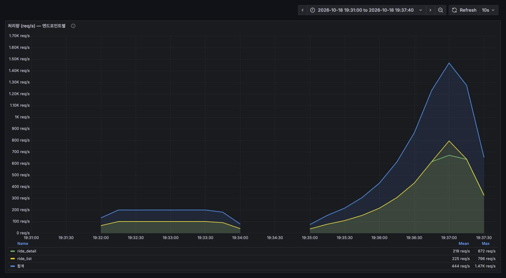
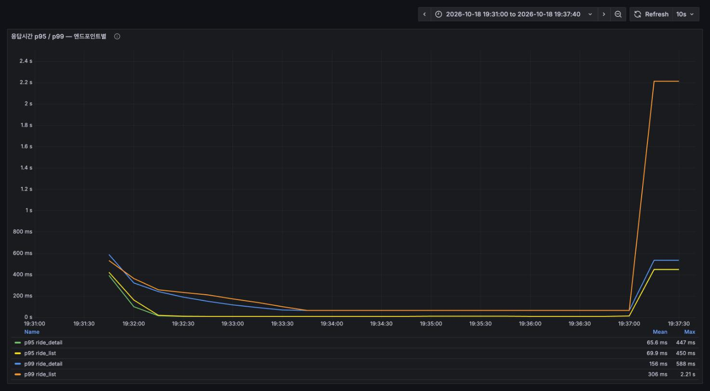
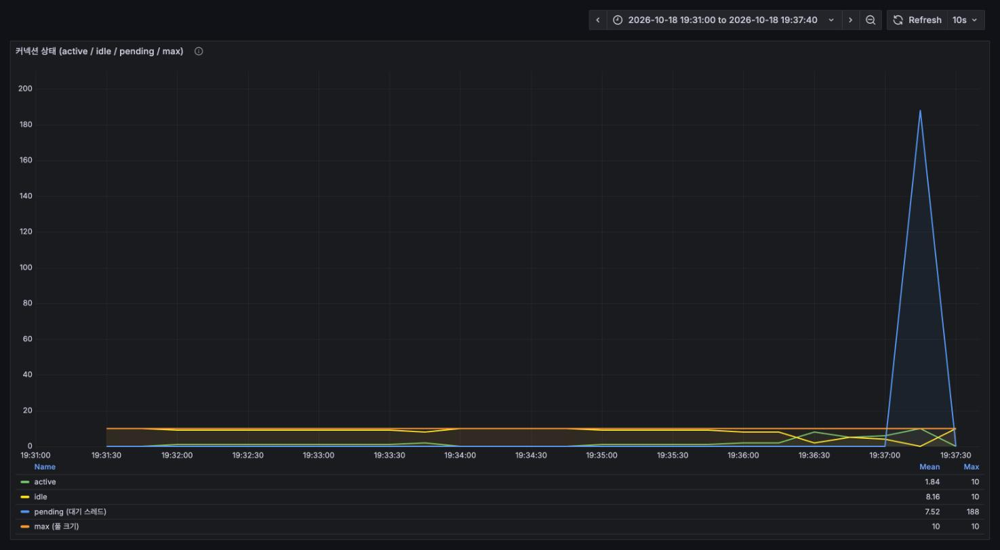
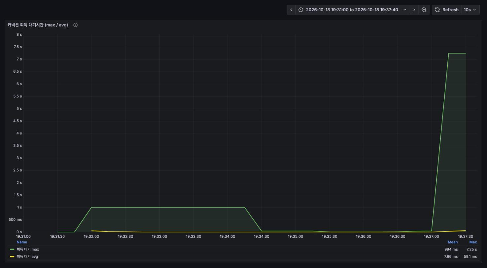
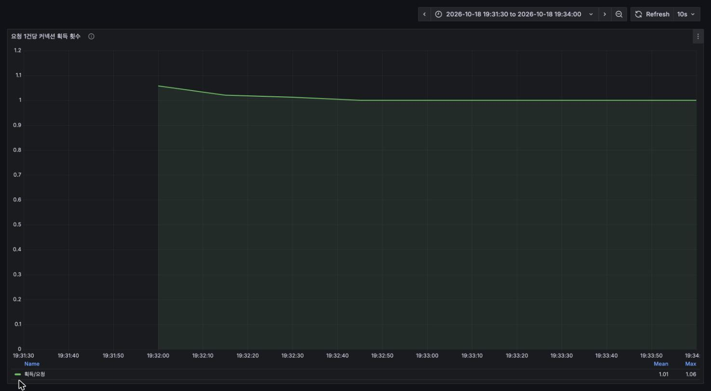
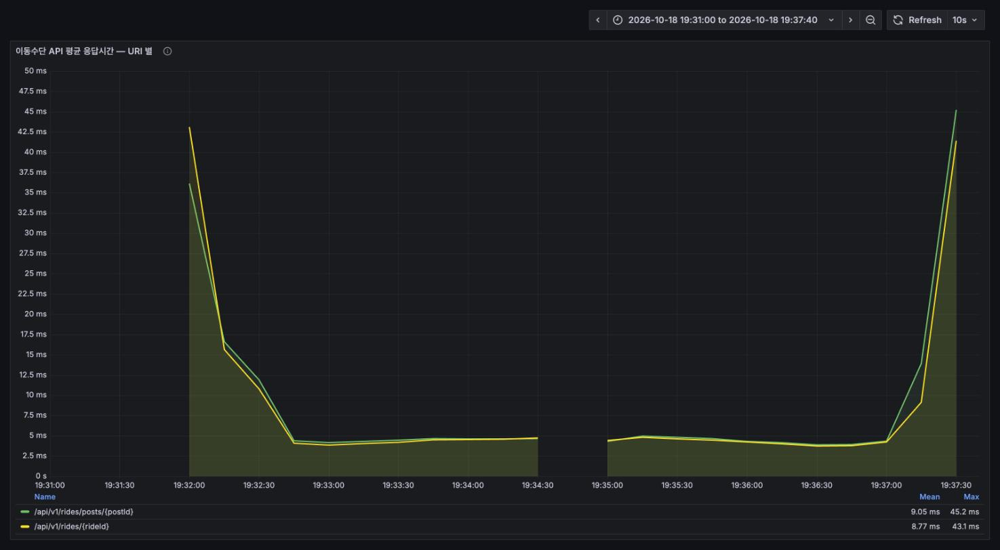

# 이동수단(ride) 도메인 부하테스트 보고서

측정일 2026-10-18 19:31–19:37 · 대상 `/api/v1/rides` 전 경로 · 도구 k6 v2.3.0 + Prometheus + Grafana

---

## 1. 요약

| 항목 | 결과 | 근거 |
|---|---|---|
| 평균 부하 (200 req/s) | **p95 9ms, 에러 0%** — 여유 있음 | [3-2](#3-2-조회-평균-부하) |
| 한계점 | **약 1,500 req/s 에서 커넥션 풀이 무너짐** | [3-3](#3-3-조회-한계점-탐색-) |
| 1차 병목 | **Hikari 풀(크기 10).** 대기 스레드 **188개**, 획득 대기 **7.25초** | [3-3](#3-3-조회-한계점-탐색-) |
| 에러율 | **0%** — 전 구간. 풀 포화가 에러가 아니라 "느린 성공"으로 나타남 | [4-①](#-hikari-connection-timeout-을-줄여라--포화가-보이게) |
| 요청당 커넥션 획득 | **1.0회** (결제는 4.0회) | [3-4](#3-4-요청-1건당-커넥션-획득-횟수) |
| 기능 검증 | 체크 12종 전부 통과 (소유권 검증 포함) | [3-1](#3-1-스모크--기능-검증) |
| 치명적 결함 | 없음. 다만 **목록 API 에 소유권 검증이 없습니다** | [5](#5-부하와-무관하게-눈에-띈-것) |

**이 도메인의 핵심은 "결제에서 재현되지 않았던 커넥션 풀 포화가 여기서는 선명하게 재현됐다"는 점입니다.**
결제 재측정은 3,096 req/s 에서도 pending 0 이었는데, 이동수단은 1,500 req/s 부근에서 대기 스레드가
188개까지 쌓이고 획득 대기가 7.25초까지 벌어졌습니다.

---

## 2. 측정 환경

결제 도메인과 **같은 인스턴스·같은 설정**입니다. 공통 사항은 [../../README.md](../../README.md) 참고.

| 항목 | 값 |
|---|---|
| 애플리케이션 | `java -jar` (bootJar), 포트 8080, profile `dev`, `ddl-auto=update` 로 덮어씀 |
| 로깅 | `org.hibernate.SQL=WARN`, `jdbc.bind=WARN`, SQL 포매팅 off |
| DB | MySQL 8.0 (Docker, 127.0.0.1:3307) |
| Hikari 풀 | **max 10** (설정에 없어 기본값) |
| 모니터링 | Prometheus v3.7.3 (15s 스크랩) + Grafana 12.2.0 |
| 부하 생성 | k6 v2.3.0, **동일 머신** (macOS / Apple Silicon) |
| 시드 | `client03` 에 `[LT-RIDE]` 공고 2,000건 + ride 4,000건 (공고당 2건) |
| 대시보드 | `monitoring/grafana/dashboards/ride-loadtest.json` (`uid: ride-loadtest`) |

### 이 도메인에서만 다른 것

**① 전부 읽기 테스트입니다.** `RideController` 가 노출하는 건 GET 둘뿐입니다
(이동수단 변경 `PUT` 은 주석 처리, `move`/`arrive` 는 엔드포인트 없이 application 도메인에서 내부 호출).
그래서 `reset.sql` 도 동시성 시나리오도 없습니다 — 소모할 상태도, 경쟁할 쓰기도 없습니다.

**② 시딩 없이는 테스트 자체가 불가능합니다.** `ride` 는 `PostService.createPost` 안의
`RideService.createRide` 로만 생기는데 `BaseInitData` 는 `postRepository.save()` 로 공고를 바로
저장해 그 경로를 타지 않습니다. 측정 시작 시점의 **dev DB ride 테이블은 0건**이었습니다.

**③ k6 를 `--system-tags` 를 줄여서 돌렸습니다.**

```
--system-tags 'proto,status,method,group,check,error,error_code,scenario,expected_response'
```

`url`,`name` 을 빼지 않으면 postId/rideId 마다 Prometheus 시리즈가 쪼개져 `rate()` 가 과소 집계됩니다
(결제 보고서가 겪은 문제). 이번엔 시리즈가 6개로 합쳐져 **k6 처리량·백분위수 패널이 그대로 맞습니다.**

### 시나리오와 시각

| 시나리오 | 구간 | 명령 |
|---|---|---|
| ride-load | 19:31:37 – 19:33:40 | `-e STAGE=load -e RATE=100 -e DURATION=2m read.js` |
| ride-stress | 19:34:40 – 19:37:12 | `-e STAGE=stress -e STAGE_DURATION=30s read.js` |

1 iteration = 목록 1건 + 상세 1건 = **2 요청**입니다. `RATE=100` 은 200 req/s 입니다.

---

## 3. 결과

### 3-1. 스모크 — 기능 검증

1 VU 로 전 경로 1회. **체크 12종 전부 통과.**

| 확인한 것 | 결과 |
|---|---|
| 목록 200 / `200-81` / 공고당 2건 / 방향 두 종류 | ✓ |
| 상세 200 / `200-82` / id 일치 / 출발·도착 주소 채워짐 | ✓ |
| **남의 ride 상세 → 403 `403-81`** | ✓ 막힘 |
| **남의 공고 목록 → 200** | ✓ 안 막힘 ([5절](#5-부하와-무관하게-눈에-띈-것)) |

### 3-2. 조회 — 평균 부하

100 iter/s(= 200 req/s), 2분.

| 엔드포인트 | p95 | p99 | 실패율 |
|---|---|---|---|
| `GET /rides/posts/{postId}` (목록) | 8.90ms | — | 0% |
| `GET /rides/{rideId}` (상세) | 9.13ms | 63.77ms | 0% |

총 24,316 req / **198.13 req/s** / 체크 47,852건 전부 통과. 임계값 전원 통과.
Hikari pending 0, 서버 측 평균 4.2~4.4ms.

목록과 상세가 거의 같습니다. 둘 다 "ride 조회 + post LAZY 로딩" 이라는 같은 모양이기 때문입니다.

### 3-3. 조회 — 한계점 탐색 ⭐

50 → 100 → 200 → 400 → 800 → 1,200 iter/s 로 30초씩.

| 지표 | 값 |
|---|---|
| 달성 처리량 | 평균 716.8 req/s, **피크 1,468 req/s** (총 108,877 req) |
| 실패율 | **0%** |
| p95 (목록 / 상세) | **449.94ms / 447.08ms** ← 임계값 300ms **초과** |
| p99 (전체) | **2.7s** |
| max | **7.55s** |
| dropped_iterations | **9,862** (maxVUs 800 소진) |
| **Hikari pending** | **188** |
| **Hikari 획득 대기 (max)** | **7.25초** |
| Hikari timeout | **0건** |
| 시스템 CPU (peak) | 94.9% (JVM 프로세스 42.9%) |

k6 임계값이 깨졌습니다 (`p(95)<300` 위반, 종료 코드 99).



*앞쪽 평평한 200 req/s 가 평균 부하, 뒤쪽 계단이 한계점 탐색. 마지막 단계에서 1,468 req/s 까지 올라갑니다.*



*19:37 직전까지 한 자릿수 ms 에 붙어 있다가 **절벽처럼 꺾입니다.** 목록 p99 가 2.21초까지 치솟습니다.
앞쪽 19:31:45 의 봉우리는 JIT 워밍업입니다.*



**이 그래프가 이 보고서의 핵심입니다.** 풀 크기는 10(주황)인데 **대기 스레드(파랑)가 188까지 쌓입니다.**
active 는 10에 붙어 더 올라갈 수 없고, 나머지 요청은 전부 줄을 섭니다.



*같은 순간 커넥션 하나를 받기까지 **최대 7.25초**를 기다립니다. 평균은 59ms.*

**해석.** 이동수단 조회는 1,500 req/s 부근에서 **커넥션 풀(10)이 명확한 병목**입니다.
`hikaricp_connections_timeout_total` 이 0인 것은 괜찮다는 뜻이 아니라, Hikari 기본 타임아웃이 30초라
7초를 기다린 요청도 **"느린 성공"으로 집계되기 때문**입니다. 그래서 실패율이 0% 로 보입니다.

> ⚠️ **다만 이 한계점 수치를 서버의 절대 상한으로 읽지 마세요.** k6·서버·MySQL 이 같은 머신이고
> 피크에서 시스템 CPU 가 94.9%, k6 가 maxVUs 800 을 다 쓰고 9,862 반복을 떨궜습니다. 부하 생성기 쪽
> 포화가 섞여 있습니다. **반면 pending 188 / 획득 대기 7.25초는 서버가 스스로 집계한 값이라,
> 풀이 병목이라는 사실 자체는 생성기와 무관하게 성립합니다.**

### 3-4. 요청 1건당 커넥션 획득 횟수



**정확히 1.0회입니다.** 결제 승인·취소가 4.0회였던 것과 대비됩니다.

이동수단은 `RideService` 에 `@Transactional(readOnly = true)` 가 클래스 레벨로 걸려 있어
한 요청이 **커넥션 하나를 잡고 그 안에서 쿼리를 여러 번** 날립니다. 두 경로 모두 Post 를 LAZY 로
끌어오므로 쿼리 수는 1보다 많지만, **커넥션 획득은 1회**입니다.

- 목록: ride 조회 → `RideResponse` 가 `ride.getPost()` 의 좌표·주소를 읽으며 post 추가 SELECT
- 상세: ride 조회 → `validUser` 가 `ride.getPost().getClient()` 를 타며 post 추가 SELECT

`RideRepository` 의 쿼리가 `join Post p` 를 쓰지만 **fetch join 이 아니라서** 생기는 비용입니다.

> 즉 이 도메인에서 풀이 터진 이유는 "커넥션을 많이 잡아서"가 아니라 **"한 번 잡은 커넥션을
> 쿼리 여러 개 도는 동안 붙잡고 있어서"** 입니다. 결제 취소에서 본 것과 같은 구조의 문제입니다.

### 3-5. 서버가 본 응답시간



서버 집계 평균은 한계점 구간 내내 **4~5ms** 를 유지하다가 마지막에야 45ms 로 올라갑니다.
k6 가 본 p95 450ms 와 차이가 큽니다. 이유는 둘입니다.

1. **평균 대 백분위수.** 서버 지표에는 백분위수 히스토그램이 없어 평균밖에 못 봅니다
   ([4-③](#-서버-측-응답시간-백분위수를-노출)). 꼬리가 평균에 묻힙니다.
2. **Tomcat 큐 대기가 서버 타이머 밖에 있습니다.** `http_server_requests_seconds` 는 요청이 워커
   스레드에 올라간 뒤부터 잽니다. 800 VU 가 몰리면 그 앞에서 기다리는 시간이 더 있는데
   `tomcat_threads_busy` 가 노출돼 있지 않아 확인할 수 없었습니다 ([4-④](#-tomcat-스레드-지표-노출)).

---

## 4. 권고 (우선순위)

### ① Hikari `connection-timeout` 을 줄여라 — 포화가 보이게

이번 측정에서 **7.25초를 기다린 요청이 에러로 집계되지 않았습니다.** 기본 타임아웃이 30초라
풀 포화가 전부 "느린 성공"이 됩니다. 실패율 0% 를 보고 "문제 없음"으로 읽으면 사고가 납니다.

```yaml
spring:
  datasource:
    hikari:
      maximum-pool-size: 20     # 코어수·DB max_connections 보고 조정
      connection-timeout: 3000  # 30초 기본값이 장애를 가린다
```

풀 크기도 설정에 없어 **기본값 10에 암묵적으로 기대고 있는 상태**입니다. 값을 적어 두세요.

### ② `RideRepository` 에 fetch join 을 걸어라

두 경로 모두 post 를 추가 SELECT 로 끌어옵니다. 커넥션 점유 시간이 그만큼 길어지고,
그게 ①의 포화를 앞당깁니다.

```java
@Query("select r from Ride r join fetch r.post p where p.id = :postId")
List<Ride> findAllByPostId(@Param("postId") Long postId);
```

상세(`findById`)는 `JpaRepository` 기본 메서드라 fetch join 을 걸 수 없으니, post 를 함께 가져오는
전용 쿼리를 추가하는 편이 낫습니다.

> ⚠️ **상세 경로는 지금 우연히 동작합니다.** `open-in-view: false` 인데 컨트롤러가 트랜잭션 **밖에서**
> `new RideResponse(ride)` 를 만들며 post 필드를 읽습니다. 터지지 않는 유일한 이유는 바로 앞의
> `validUser` 가 `ride.getPost().getClient()` 를 타면서 트랜잭션 안에서 post 를 이미 초기화했기
> 때문입니다. **소유권 검증을 지우거나 순서를 바꾸면 `LazyInitializationException` 이 납니다.**
> fetch join 으로 명시하면 이 의존이 사라집니다.

### ③ 서버 측 응답시간 백분위수를 노출

`http_server_requests_seconds_bucket` 이 없어 서버 기준 p95/p99 를 계산할 수 없습니다.
이번에도 평균(4ms)과 k6 p95(450ms) 사이를 설명하는 데 애를 먹었습니다.

```yaml
management:
  metrics:
    distribution:
      percentiles-histogram:
        http.server.requests: true
```

### ④ Tomcat 스레드 지표 노출

`tomcat_threads_busy` / `_config_max_threads` 가 없어 스레드 포화를 확인할 수 없었습니다.
풀 포화와 스레드 포화를 구분하려면 필요합니다.

```yaml
server:
  tomcat:
    mbeanregistry:
      enabled: true
```

### ⑤ 부하 생성기를 다른 머신으로

한계점 구간에서 시스템 CPU 94.9%, k6 가 VU 800 을 소진하고 9,862 반복을 떨궜습니다.
**1,500 req/s 라는 숫자는 이 측정 구성의 상한이지 서버의 상한이 아닙니다.** 결제 보고서와 같은 한계입니다.

---

## 5. 부하와 무관하게 눈에 띈 것

### 목록 API 에 소유권 검증이 없습니다

`GET /api/v1/rides/posts/{postId}` 는 **로그인한 아무나 남의 공고 이동 정보를 볼 수 있습니다.**

- `SecurityConfig` 에서 `/api/v1/rides/**` 가 따로 안 걸려 있어 `"/api/**" → authenticated()` 로만 통과합니다
- `RideController.getListByPostId` 는 `@AuthenticationPrincipal` 을 받지도 않습니다
- 같은 도메인의 상세(`GET /rides/{rideId}`)는 `RideService.validUser` 로 작성자만 통과시킵니다 — **둘의 기준이 다릅니다**

응답에는 픽업 주소·병원 주소·좌표가 들어 있습니다. 스모크에 지금 동작을 체크로 박아 두었으니
(`'남의 공고 목록은 현재 200 (소유권 검증 없음)'`), 서버에 검증이 추가되면 그 체크가 깨지면서 알려 줍니다.

> 부하테스트에서 나온 관찰이라 보안 검토를 대신하지는 않습니다. 의도된 공개인지 확인이 필요합니다.

### dev 환경에 ride 데이터가 아예 없습니다

측정 전 `ride` 테이블은 **0건**이었습니다. `BaseInitData` 가 `postRepository.save()` 로 공고를 만들어
`PostService.createPost` 의 `createRide` 를 타지 않기 때문입니다. 즉 **dev 로 띄운 화면에서는
이동수단 API 가 항상 빈 배열을 돌려줍니다.** 프런트 개발·QA 에서 이 경로가 검증되지 않았을 수 있습니다.

---

## 6. 결제 도메인과 비교

| | 결제 (읽기) | 이동수단 (읽기) |
|---|---|---|
| 피크 처리량 | 3,096 req/s | 1,468 req/s |
| 그 때 p99 | 5.24ms | 2.7s |
| Hikari pending | **0** | **188** |
| 획득 대기 max | 16ms | **7.25초** |
| 요청당 커넥션 획득 | 1.0 | 1.0 |
| 사용 VU | 80 | **800 (소진)** |

같은 풀 크기(10)인데 결과가 반대입니다. 결제 읽기 테스트는 결제가 6건뿐인 `client01` 을 대상으로
작고 단순한 쿼리를 돌렸고, 이동수단은 공고 2,000건·ride 4,000건에 걸쳐 **요청마다 다른 행**을 집으며
**post 를 추가로 끌어옵니다.** 캐시 지역성이 없고 쿼리가 더 길어 커넥션 점유 시간이 깁니다.

**결제 보고서가 "풀 포화가 재현되지 않았다"고 남긴 미결 항목이, 이 도메인에서 재현됐습니다.**
풀 크기 10은 워크로드에 따라 충분하기도 하고 아니기도 합니다 — 명시적으로 설정하고
`connection-timeout` 을 줄여 포화가 드러나게 하는 쪽이 안전합니다.

---

## 7. 재현 방법

```bash
cd /Users/admin/DevCProject
set -a && . ./.env && set +a

# 1) 측정용 인스턴스 (공통 README 3절)
java -jar build/libs/NBE-12-14-2-Team06-0.0.1.jar \
  --server.port=8080 --spring.profiles.active=dev \
  --spring.jpa.hibernate.ddl-auto=update \
  --logging.level.org.hibernate.SQL=WARN \
  --logging.level.org.hibernate.orm.jdbc.bind=WARN

# 2) 서버가 뜬 뒤에 시딩
docker exec -i escort-mysql mysql -uroot -p"$MYSQL_ROOT_PASSWORD" escort < loadtest/ride/sql/seed.sql

# 3) 스모크 → 부하
export K6_PROMETHEUS_RW_SERVER_URL=http://localhost:9090/api/v1/write
export K6_PROMETHEUS_RW_TREND_STATS='p(95),p(99),max'
SYSTAGS='proto,status,method,group,check,error,error_code,scenario,expected_response'

k6 run loadtest/ride/smoke.js

k6 run -o experimental-prometheus-rw --tag run=ride-load --system-tags "$SYSTAGS" \
  -e STAGE=load -e RATE=100 -e DURATION=2m loadtest/ride/read.js

k6 run -o experimental-prometheus-rw --tag run=ride-stress --system-tags "$SYSTAGS" \
  -e STAGE=stress -e STAGE_DURATION=30s loadtest/ride/read.js

# 4) 정리
docker exec -i escort-mysql mysql -uroot -p"$MYSQL_ROOT_PASSWORD" escort < loadtest/ride/sql/teardown.sql
```

읽기 전용이라 실행 사이에 `reset` 이 필요 없습니다.

Grafana: <http://localhost:3001> → GAJI 폴더 → **이동수단 도메인 부하테스트 (k6 + Hikari)**
(`uid: ride-loadtest`). 패널 하나만 크게 보려면 URL 에 `&viewPanel=panel-107&kiosk`.

---

## 8. 측정 후 DB 상태

`teardown.sql` 로 시드를 전부 정리했습니다. 삭제 범위는 `[LT-RIDE]` 접두어 공고와 거기 달린 행뿐입니다.

| 테이블 | 복구 후 |
|---|---|
| post | 16 |
| ride | **0** (측정 전과 동일) |
| 남은 시드 공고 | 0 |
