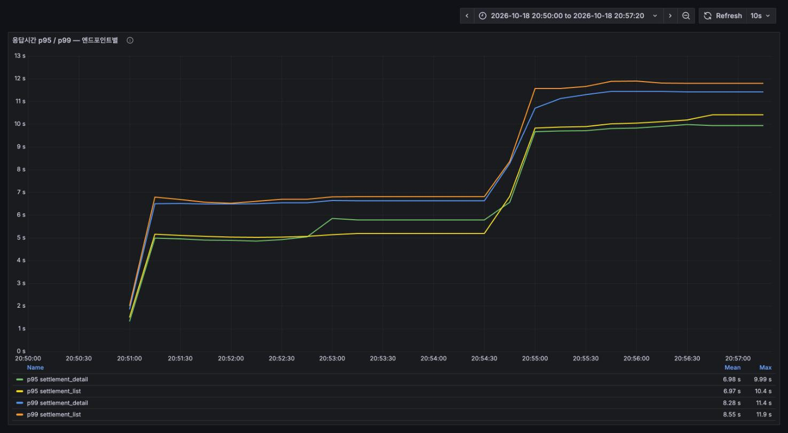
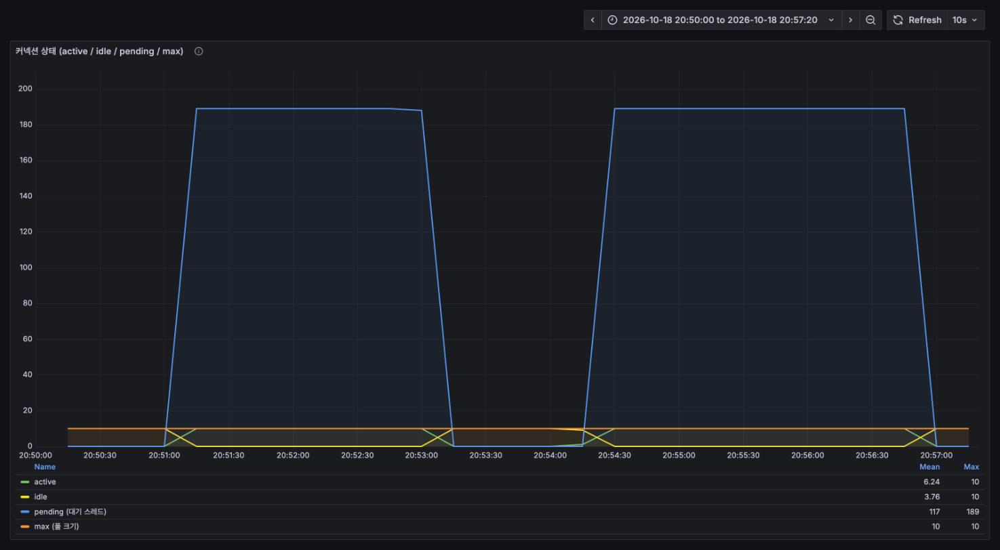
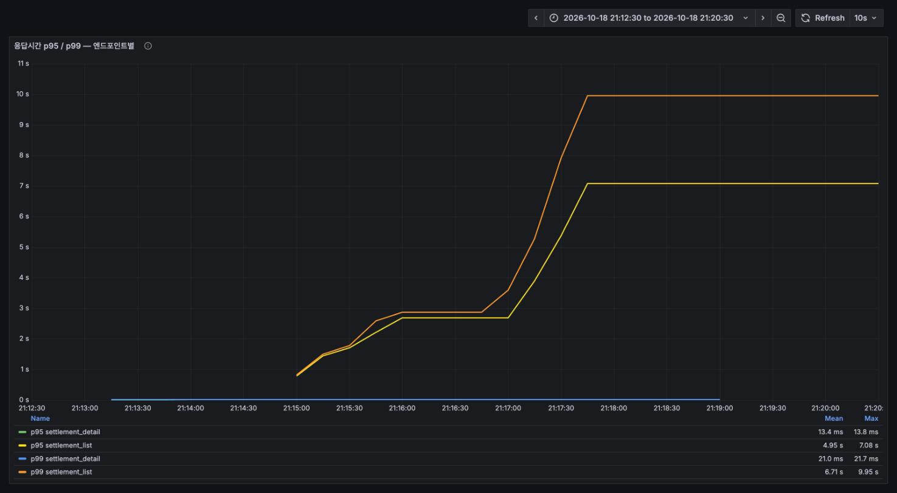
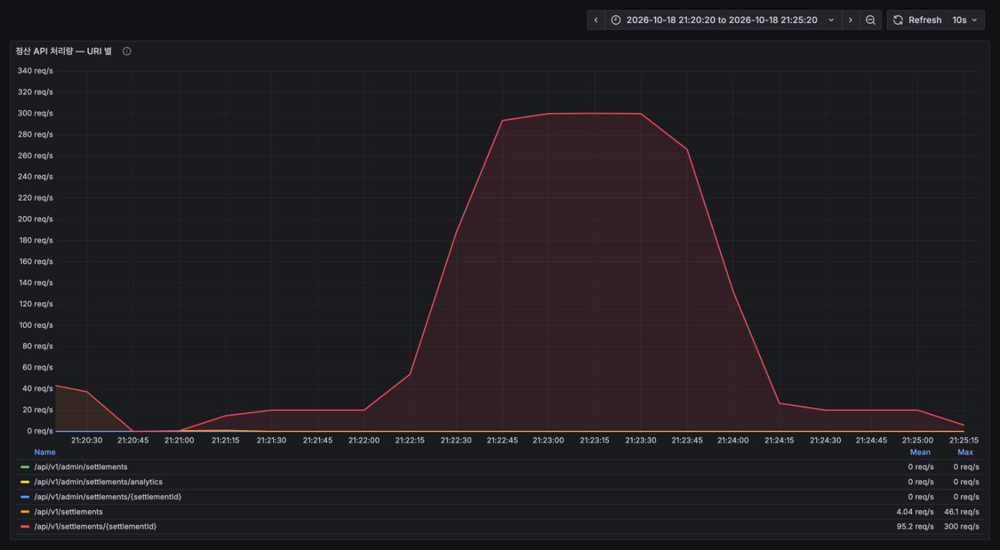
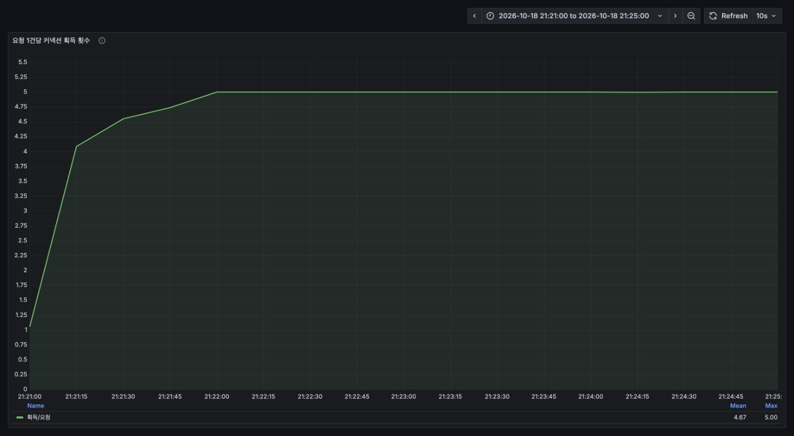
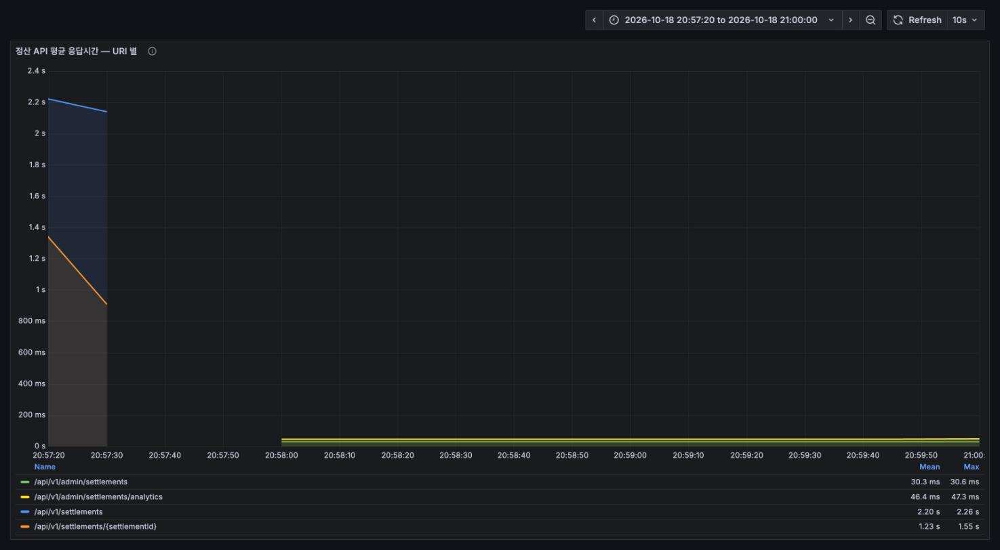

# 정산(settlement) 도메인 부하테스트 보고서

측정일 2026-10-18 20:50–21:25 · 대상 `/api/v1/settlements`, `/api/v1/admin/settlements` 전 경로
도구 k6 v2.3.0 + Prometheus + Grafana

---

## 1. 요약

| 항목 | 결과 | 근거 |
|---|---|---|
| **중복 정산 (관리자 경로)** | **동시 20건 중 6건이 통과** — 50라운드 전부 | [3-2](#3-2-동시성-정합성-) |
| 중복 정산 (동행 매니저 경로) | **정확히 1건만 통과** — 방어선 정상 | [3-2](#3-2-동시성-정합성-) |
| **정산 목록 조회** | **200 req/s 도 못 버팀.** p95 5.2초, 커넥션 풀 포화 | [3-3](#3-3-조회--목록이-병목이다-) |
| 정산 상세 조회 | 50 req/s 에서 p95 15ms — 빠름. 목록에 끌려 같이 죽음 | [3-4](#3-4-진단--목록과-상세를-떼어-재다-) |
| 정산 요청 (쓰기) | 300 req/s 급증을 전부 소화 (p95 36ms, 에러 0%) | [3-5](#3-5-정산-요청--부하) |
| 요청당 커넥션 획득 | **5.0회** (결제 4.0, 이동수단 1.0) | [3-6](#3-6-요청-1건당-커넥션-획득-횟수) |
| 관리자 조회 | 목록 30ms / 통계 46ms — 빠름 | [3-7](#3-7-관리자-조회) |
| 기능 검증 | 체크 23종 전부 통과 | [3-1](#3-1-스모크--기능-검증) |

**가장 먼저 손댈 곳은 관리자 정산 요청의 동시성입니다.** 돈이 중복으로 나가는 경로이고,
지금은 목(mock) 클라이언트라 드러나지 않을 뿐입니다.

---

## 2. 측정 환경

결제·이동수단 도메인과 **같은 인스턴스·같은 설정**입니다. 공통 사항은 [../../README.md](../../README.md) 참고.

| 항목 | 값 |
|---|---|
| 애플리케이션 | `java -jar` (bootJar), 포트 8080, profile `dev`, `ddl-auto=update` 로 덮어씀 |
| 로깅 | `org.hibernate.SQL=WARN`, `jdbc.bind=WARN`, SQL 포매팅 off |
| DB | MySQL 8.0 (Docker, 127.0.0.1:3307) |
| Hikari 풀 | **max 10** (설정에 없어 기본값) |
| 모니터링 | Prometheus v3.7.3 (15s 스크랩) + Grafana 12.2.0 |
| 부하 생성 | k6 v2.3.0, **동일 머신** (macOS / Apple Silicon), `--system-tags` 에서 `url,name` 제외 |
| 시드 | `escort01` 에 공고:지원:정산 1:1:1 — PENDING 8,000 / COMPLETED 4,000 (스파이크 재측정 때 PENDING 38,000) |
| 대시보드 | `monitoring/grafana/dashboards/settlement-loadtest.json` (`uid: settlement-loadtest`) |
| 스케줄러 | `SettlementScheduler` 는 평일 10시 — 측정 구간(20~21시)과 겹치지 않음 |

### 이 도메인에서만 다른 것

**① 외부 정산 API 가 목입니다.** `MockSettlementClient` 가 받은 값을 그대로 돌려줍니다.
실제 금융결제원 호출이 없어 **외부 API 지연이 0 으로 측정됩니다.** 아래 요청 수치는 낙관적 하한선입니다.

**② 두 역할이 서로 다른 API 를 씁니다.** 동행 매니저(`/settlements`)와 관리자(`/admin/settlements`)를
각각 쟀고, **같은 동작(정산 요청)인데 방어선이 다르다**는 점이 이번 측정의 핵심 발견입니다.

**③ 시딩 없이는 테스트 자체가 불가능합니다.** 정산은 동행 완료 시
`SettlementService.createSettlement` 로만 생기는데 `BaseInitData` 는 그 경로를 타지 않습니다.
측정 시작 시점의 **dev DB settlement 테이블은 0건**이었습니다.

### 시나리오와 시각

| 시나리오 | 구간 | 결과 |
|---|---|---|
| setl-read-load | 20:50:54 – 20:53:00 | 임계값 **실패** |
| setl-read-stress | 20:54:00 – 20:56:40 | 임계값 **실패** |
| setl-admin | 20:57:40 – 20:59:41 | 통과 |
| setl-race-user | 21:00:41 – 21:00:44 | 통과 |
| setl-race-admin | 21:01:44 – 21:01:47 | **중복 정산 50건 검출** |
| setl-request-load | 21:02:47 – 21:04:49 | 통과 |
| setl-request-spike (1차) | 21:05:49 – 21:09:51 | **무효** — 시드 부족([6절](#6-측정-중-발견한-스크립트-문제)) |
| diag-detail-only / list-only / list-indexed / control | 21:12:58 – 21:20:14 | 진단 |
| setl-request-spike (2차) | 21:20:42 – 21:24:51 | 통과 |

---

## 3. 결과

### 3-1. 스모크 — 기능 검증

1 VU 로 전 경로 1회. **체크 23종 전부 통과.**

조회(목록·상세) / 정산 요청 / 중복 요청 차단 / COMPLETED 재요청 차단 / 소유권(상세 403-71,
요청 404-71) / 관리자 목록·통계 / 비관리자 차단까지 확인했습니다.

### 3-2. 동시성 정합성 ⭐

같은 `settlementId` 에 **동시 20건**을 `http.batch` 로 때리고 50라운드 반복했습니다.

| 경로 | 라운드당 성공 | 중복 | 결과 |
|---|---|---|---|
| 동행 매니저 `POST /api/v1/settlements/{id}` | **정확히 1건** (avg=min=max=1) | 0 | ✅ |
| 관리자 `POST /api/v1/admin/settlements/{id}` | **정확히 6건** (avg=min=max=6) | **50라운드 전부** | ❌ |

두 경로의 조건부 UPDATE 가 다릅니다.

```java
// SettlementRepository.updateProcessing — 동행 매니저 경로. CAS 성립
update Settlement s set s.settlementStatus=PROCESSING
 where s.id=:settlementId
   and (s.settlementStatus=PENDING or s.settlementStatus=FAILED)

// SettlementRepository.updateProcessingForAdmin — 관리자 경로. PROCESSING 이 WHERE 에 있다
update Settlement s set s.settlementStatus=PROCESSING
 where s.id=:settlementId
   and s.settlementStatus in (PENDING, FAILED, PROCESSING)
```

관리자 경로에 `PROCESSING` 이 포함돼 있어 **이미 정산 중인 건도 통과**합니다.
컨트롤러 설명에도 "정산 상태가 PROCESSING이어도 정산이 요청됩니다"라고 적혀 있으니
**멈춘 건을 다시 밀어 넣으려는 의도는 분명합니다.**

문제는 그 의도가 *순차 재시도* 를 가정한다는 점입니다. 동시 요청에서는 여러 건이 같은 창을 통과해
**`settlementApi()` 가 그만큼 호출됩니다.** 지금은 `MockSettlementClient` 라 아무 일도 안 일어나지만,
실제 금융결제원 클라이언트로 바뀌면 **한 건에 6번 송금**입니다.

> 왜 하필 6건인지는 풀 크기(10)와 첫 요청이 COMPLETED 를 커밋하기까지의 창이 맞물린 결과로 보입니다.
> 숫자 자체보다 **"1이 아니다"** 가 중요합니다.

최종 상태는 두 경로 모두 50라운드 전부 `COMPLETED` 였습니다 — DB 상태만 보면 멀쩡해 보인다는 뜻이라
더 위험합니다.

### 3-3. 조회 — 목록이 병목이다 ⭐

100 iter/s(= 목록 + 상세 200 req/s) 를 목표로 했는데 **90 req/s 밖에 못 냈습니다.**

| 지표 | load (목표 200 req/s) | stress (목표 최대 2,400 req/s) |
|---|---|---|
| 달성 처리량 | **90.2 req/s** | **94.7 req/s** |
| p95 목록 / 상세 | **5.19s / 5.78s** | **10.41s / 9.93s** |
| p99 (전체) | 6.76s | 11.65s |
| max | 11.36s | 16.8s |
| 실패율 | **0%** | **0%** |
| dropped_iterations | 6,529 | 56,586 |
| 사용 VU | 400 (소진) | 800 (소진) |
| Hikari pending | **189 (평탄)** | **189 (평탄)** |
| Hikari 획득 대기 max | **8.81초** | 8.81초 |
| 요청당 커넥션 획득 | 1.0 | 1.0 |
| JVM CPU | **16.3%** | — |



*load 구간에서 이미 p95 가 5~7초입니다. stress 로 넘어가면 10초대로 올라갑니다.*



**pending 이 스파이크가 아니라 189 에서 평탄선을 그립니다.** 풀(10)이 처음부터 끝까지 꽉 차 있고
요청은 계속 줄을 섭니다. 이동수단 도메인이 마지막 단계에서만 잠깐 터졌던 것과 다릅니다.

**JVM CPU 가 16% 밖에 안 됩니다.** 서버가 일하느라 느린 게 아니라 **기다리느라** 느립니다.

### 3-4. 진단 — 목록과 상세를 떼어 재다 ⭐

둘을 같이 돌리면 느린 쪽이 풀을 메워 빠른 쪽까지 끌어내립니다. `-e ONLY=` 로 분리해 50 iter/s 로 재측정했습니다.

| 측정 | avg | p95 | dropped |
|---|---|---|---|
| **상세만** (`ONLY=detail`) | **9.34ms** | **15.24ms** | 0 |
| **목록만** (`ONLY=list`) | 1.60s | **2.78s** | 93 |
| 목록만 + `post(escort_start_at)` 인덱스 | 4.24s | **8.26s** | 301 |
| 목록만 (인덱스 제거 후 대조군) | 1.76s | **2.96s** | 111 |



*같은 50 iter/s 인데 상세는 바닥에 붙어 있고(p95 13.4ms) 목록만 초 단위로 치솟습니다.*

**범인은 목록입니다.** 상세는 혼자 돌리면 p95 15ms 로 멀쩡합니다 — 본 측정에서 5.78초가 나온 건
목록이 풀을 다 써버려서 **커넥션을 기다린 시간**입니다.

#### 목록 쿼리가 왜 느린가

`SettlementRepository.findAllByUserIdAndDate` 의 실행 계획입니다.

```
-> Limit/Offset: 10/100  (actual time=7.15..7.19 rows=10)
    -> Nested loop inner join
        -> Sort: p.escort_start_at DESC  (actual time=6.7..6.71 rows=112)
            -> Filter: p.escort_start_at between ...  (actual rows=12003)
                -> Table scan on p  (cost=1262 rows=11656) (actual rows=12016)
```

**옵티마이저가 `post` 를 전체 스캔하고 정렬한 뒤 조인합니다.** 단건으로는 7ms 라 빨라 보이지만,
커넥션 10개가 **동시에** 12,000행 스캔 + 정렬을 돌리면 그대로 무너집니다. 한 요청이 커넥션을
붙잡는 시간(usage max 0.6초)이 길어지고 → 풀이 차고 → pending 189 가 됩니다.

정렬 키가 `application.post.escortStartAt` 이라 **정산에서 출발할 수가 없고**, 필터도 같은 컬럼이라
공고부터 훑게 됩니다.

> ⚠️ **인덱스 실험은 결론을 내지 못했습니다.** `post(escort_start_at)` 인덱스를 걸었더니
> 오히려 **2.8배 느려졌습니다**(p95 2.96s → 8.26s). 인덱스를 지우고 다시 재서 드리프트가 아님을
> 확인했습니다. 원인은 **시드 아티팩트**입니다 — `seed.sql` 이 `escort_start_at` 을
> `MOD(n, 25)` 일로 흩어서 **고유값이 40개뿐**이고, 조회 구간이 사실상 전건을 포함합니다.
> 선택도가 없는 인덱스를 타면 순차 스캔보다 느려집니다.
> **실제 데이터 분포에서 다시 재야 합니다** ([4-②](#-정산-목록-쿼리를-정산에서-출발하게-바꿔라)).

### 3-5. 정산 요청 — 부하

| 프로파일 | 처리량 | p95 | p99 | max | 실패율 |
|---|---|---|---|---|---|
| load (50 req/s, 2분) | 49.9 req/s (6,047건) | 19.02ms | 24.37ms | 151ms | 0% |
| spike (20 → **300** req/s, 4분) | 121.4 req/s (30,081건) | 36.48ms | 108.35ms | 369ms | 0% |



*서버가 집계한 `/api/v1/settlements/{settlementId}` 처리량. **목표 300 req/s 를 깎임 없이
전부 소화**했고 `dropped_iterations` 와 `rows_exhausted` 모두 0 이었습니다.*

피크에서 Hikari active 8/10, pending 0, 획득 대기 약 200ms. **쓰기 경로는 여유가 있습니다.**

> 단, 외부 정산 API 가 목이라 0ms 입니다. 실제 금융결제원 API 가 200~500ms 라면
> p95 36ms 가 아니라 **200ms 대**가 되고, 커넥션 점유 시간도 그만큼 늘어납니다.

### 3-6. 요청 1건당 커넥션 획득 횟수



**정확히 5.0회입니다.** 세 도메인 중 가장 많습니다 (결제 4.0, 이동수단 1.0).

> **5회가 전부 요청 스레드는 아닙니다.** 마지막 알림(`NoticeService.send`)은 `@Async` +
> `@Transactional` 이라 별도 스레드에서 돕니다 — **요청 스레드 4회 + 비동기 1회**입니다.
> 이 지표는 스레드를 가리지 않고 같은 풀에서 나간 커넥션을 전부 세므로, 풀 포화 관점에서는
> 5회가 맞고 **요청 지연 관점에서는 4회**로 읽어야 합니다.

`SettlementService.request` 에 `@Transactional` 이 없고 `SettlementPersistenceService` 의
메서드들이 각자 트랜잭션을 엽니다.

```java
settlementPersistenceService.findAccountDto(userId, settlementId);  // ① readOnly 트랜잭션
settlementPersistenceService.processingSettlement(settlementId);    // ② 조건부 UPDATE
settlementApi(...);                                                 //   외부 호출 (트랜잭션 밖 — 올바름)
settlementPersistenceService.updateSettlement(id, COMPLETED);       // ③ 상태 반영
settlementPersistenceService.findById(settlementId);                // ④ 알림용 재조회 (요청 스레드)
noticeService.send(...);                                            // ⑤ 알림 저장 (@Async — 별도 스레드)
```

외부 호출을 트랜잭션에 넣지 않으려는 구조라 방향은 맞지만, **풀 크기가 10 이므로 정산 요청 2건이면
풀을 한 번씩 다 돕니다.**

### 3-7. 관리자 조회

20 iter/s(= 목록 + 통계 40 req/s), 2분.

| 엔드포인트 | p95 | 서버 평균 | 실패율 |
|---|---|---|---|
| `GET /admin/settlements` (목록, Page) | 32.8ms | 30.3ms | 0% |
| `GET /admin/settlements/analytics` (통계) | 52.0ms | 46.4ms | 0% |



*왼쪽 끝의 2.2초 꼬리는 직전 동행 매니저 목록 테스트의 잔상입니다. 관리자 두 경로는 바닥에 붙어 있습니다.*

**통계가 예상보다 빨랐습니다.** `findAnalytics` 는 페이징 없이 `List<Settlement>` 를 전부 로드하고
자바 for 문으로 합산하는데, 12,000건 기준 46ms 였습니다.

> 다만 **구조적으로 선형 증가**입니다. 기본 조회 구간이 최근 7일이라 정산량이 늘면 그대로 비례합니다.
> 집계를 SQL 로 내리면 상수에 가까워집니다 ([4-④](#-통계는-sql-집계로-내려라)).

---

## 4. 권고 (우선순위)

### ① 관리자 정산 요청에 동시성 방어를 넣어라 — 돈이 중복으로 나간다

재시도 의도는 유지하되, **동시 요청이 같은 창을 통과하지 못하게** 해야 합니다. 선택지는 세 가지입니다.

**(a) PROCESSING 재시도에 시간 조건을 건다** — 의도를 가장 잘 보존합니다.

```java
@Modifying
@Query("update Settlement s set s.settlementStatus = SettlementStatus.PROCESSING, s.updatedAt = :now " +
       "where s.id = :settlementId " +
       "and (s.settlementStatus in (PENDING, FAILED) " +
       "     or (s.settlementStatus = PROCESSING and s.updatedAt < :staleBefore))")
int updateProcessingForAdmin(Long settlementId, LocalDateTime now, LocalDateTime staleBefore);
```

"멈춘 지 N분 지난 PROCESSING 만 재시도" 가 되어, 동시에 들어온 요청 중 하나만 통과합니다.

**(b) 비관적 락** — `findByIdAndState` 에 `@Lock(PESSIMISTIC_WRITE)`.

**(c) 외부 송금 API 에 멱등키** — 근본적으로는 이쪽이 맞습니다. 같은 `settlementId` 로는
한 번만 송금되도록 `Idempotency-Key` 를 실어 보내면, 애플리케이션 경쟁과 무관하게 안전해집니다.
실제 클라이언트를 붙일 때 같이 설계하세요.

어느 쪽을 택하든 `request-race.js -e MODE=admin` 으로 검증할 수 있습니다. 고치고 나면
그 스크립트의 임계값을 `MODE=user` 와 같게 올리세요.

### ② 정산 목록 쿼리를 "정산에서 출발"하게 바꿔라

지금은 정렬·필터 키가 `post.escortStartAt` 이라 옵티마이저가 공고를 전체 스캔합니다.
**200 req/s 도 못 버티는 직접 원인입니다.**

- **정렬 키를 정산이 가진 컬럼으로** — `settlement.settledDate` 나 `settlement.id` 로 정렬하면
  `settlement(escort_id, id)` 인덱스로 바로 끊을 수 있습니다. 화면 요구사항이 "동행일 기준 정렬"이라면
  `settlement` 에 동행일을 **역정규화**해 두는 편이 낫습니다.
- **`join fetch` 가 지금 동작하지 않습니다.** `findAllByUserIdAndDate` 의
  `join fetch User u on s.escort=u` / `join fetch Application a on ...` / `join fetch Post p on ...` 는
  **엔티티를 ON 으로 붙이는 형태라 실제로 페치되지 않습니다.** 측정해 보니 목록 1건당
  **SELECT 5개**(목록 + count + application + post + 인증용 users)가 나갔고, 연관 경로
  (`join fetch s.escort` / `join fetch s.application a` / `join fetch a.post p`)로 바꾸니 **3개**로 줄었습니다.
  `default_batch_fetch_size: 100` 덕에 10건이 각 1쿼리로 묶여 5개에서 멈춘 것이지, 그게 없으면 더 많습니다.
  같은 함정을 이동수단 도메인에서 먼저 확인했습니다
  ([이동수단 보고서 4-②](../../ride/reports/REPORT.md#-riderepository-에-fetch-join-을-걸어라--적용-완료-2026-10-19)).
- **그게 어렵다면 복합 인덱스** — `post(escort_start_at)` 단독은 이번 측정에서 역효과였지만
  ([3-4](#3-4-진단--목록과-상세를-떼어-재다-)), 그건 시드의 고유값이 40개뿐이라 생긴 결과입니다.
  **실제 데이터 분포로 다시 재 보고** 판단하세요.
- **count 쿼리도 같은 조인을 돕니다.** 무한 스크롤이면 `Slice` 로 바꿔 count 를 없앨 수 있습니다.

### ③ Hikari 풀 크기와 타임아웃을 명시적으로 설정

세 도메인에서 같은 권고가 반복됩니다. 지금은 설정에 값이 없어 **기본값 10 에 암묵적으로 기대는 상태**입니다.

```yaml
spring:
  datasource:
    hikari:
      maximum-pool-size: 20     # 코어수·DB max_connections 보고 조정
      connection-timeout: 3000  # 30초 기본값이 장애를 가린다
```

이번 측정에서 **8.81초를 기다린 요청이 에러로 집계되지 않았습니다.** 실패율 0% 를 보고
"문제 없음"으로 읽으면 안 됩니다.

### ④ 통계는 SQL 집계로 내려라

지금(12,000건)은 46ms 로 괜찮지만 **전건을 JVM 으로 가져와 for 문으로 더하는 구조**라 정산량에
그대로 비례합니다. `SettlementAnalyticsResponse` 가 세는 값은 전부 `SUM`/`COUNT` + `CASE` 로
표현 가능합니다. 한 번의 집계 쿼리로 바꾸면 건수와 무관하게 상수에 가까워지고 힙도 안 씁니다.

### ⑤ 정산 요청의 트랜잭션 경계 정리

요청당 커넥션 5회(요청 스레드 4 + 비동기 1)는 풀 크기 10에서 부담입니다. 외부 호출 **앞의**
DB 작업(계좌 조회 + 조건부 UPDATE)을 한 트랜잭션으로 묶으면 요청 스레드가 4회 → 3회가 되고,
④ 알림용 재조회(`findById`)는 ③에서 이미 읽은 데이터라 없애면 **2회**까지 내려갑니다.
결제 도메인에서 같은 변경을 적용해 4.0 → 3.0 으로 줄인 사례가 있습니다
([결제 보고서 권고 ③](../../payment/reports/REPORT-2026-10-18-grafana.md#-승인취소의-트랜잭션-경계-정리)).

### ⑥ 서버 측 백분위수·Tomcat 스레드 지표 노출

세 도메인 공통. `http_server_requests_seconds_bucket` 과 `tomcat_threads_busy` 가 없어
서버 기준 p95/p99 와 스레드 포화를 확인할 수 없었습니다.

```yaml
management:
  metrics:
    distribution:
      percentiles-histogram:
        http.server.requests: true
server:
  tomcat:
    mbeanregistry:
      enabled: true
```

---

## 5. 부하와 무관하게 눈에 띈 것

### 같은 "권한 없음"이 403 과 404 로 갈립니다

| 동작 | 남의 정산에 대해 | 코드 |
|---|---|---|
| 상세 조회 | `ForbiddenException(71)` | **403-71** |
| 정산 요청 | 조회 자체가 빔 | **404-71** |

`findByIdAndState(userId, settlementId)` 가 escort id 를 WHERE 에 넣어 "없음"으로 처리하기 때문입니다.
보안상으로는 404 가 더 안전하지만(존재 여부를 숨김), **같은 도메인 안에서 기준이 다른 것**은
클라이언트가 분기하기 어렵습니다.

### dev 환경에 정산 데이터가 아예 없습니다

측정 전 `settlement` 테이블은 **0건**이었습니다. 정산은 동행 완료 흐름에서만 생기는데
`BaseInitData` 가 그 경로를 타지 않기 때문입니다. **dev 로 띄운 화면에서는 정산 목록이 항상
비어 있습니다** — 이동수단 도메인과 같은 상황입니다.

---

## 6. 측정 중 발견한 스크립트 문제

**1차 스파이크 측정이 무효였습니다.** `spike` 프로파일은 약 30,000 반복을 도는데 시드 PENDING 이
8,000건뿐이라 **21,999 반복이 요청 없이 건너뛰었습니다**(`rows_exhausted`). 실제로 서버에 간 요청은
8,067건이라 "300 req/s 를 소화했다"고 말할 수 없는 상태였습니다.

`rows_exhausted` 임계값(`count==0`)이 이걸 잡아내 실패로 표시했습니다 — **스크립트가 스스로
무효 측정을 알려 준 것**입니다. PENDING 을 38,000건으로 늘려 재측정한 결과를
[3-5](#3-5-정산-요청--부하) 에 실었습니다.

> 교훈: 상태를 소모하는 시나리오는 `RATE × DURATION` 이 아니라 **프로파일 전체의 반복 수**를
> 기준으로 시드를 잡아야 합니다. `estimateIterations()` 가 그 값을 계산해 주고 있으니
> setup 경고를 흘려보내지 마세요.

---

## 7. 세 도메인 비교

| | 결제 | 이동수단 | 정산 |
|---|---|---|---|
| 조회 피크 | 3,096 req/s | 1,468 req/s | **90 req/s** |
| 그 때 p99 | 5.24ms | 2.7s | 6.76s |
| Hikari pending | 0 | 188 (마지막 단계만) | **189 (내내 평탄)** |
| 요청당 커넥션 획득 | 4.0 | 1.0 | **5.0** |
| 쓰기 피크 | 300 req/s 소화 | — (쓰기 없음) | 300 req/s 소화 |
| 동시성 방어 | ✅ 완전 | — | ⚠️ **관리자 경로 뚫림** |

**조회 성능이 도메인별로 30배 넘게 차이 납니다.** 풀 크기(10)는 같은데, 한 요청이 커넥션을
얼마나 오래 붙잡느냐가 전부를 가릅니다. 정산 목록은 요청마다 12,000행을 스캔·정렬하느라
커넥션을 0.6초까지 붙잡고, 그래서 90 req/s 에서 무너집니다.

---

## 8. 재현 방법

```bash
cd /Users/admin/DevCProject
set -a && . ./.env && set +a

# 1) 측정용 인스턴스 (공통 README 3절)
java -jar build/libs/NBE-12-14-2-Team06-0.0.1.jar \
  --server.port=8080 --spring.profiles.active=dev \
  --spring.jpa.hibernate.ddl-auto=update \
  --logging.level.org.hibernate.SQL=WARN \
  --logging.level.org.hibernate.orm.jdbc.bind=WARN

# 2) 서버가 뜬 뒤에 시딩 (스파이크까지 돌리려면 @pending_count 를 35000 이상으로)
docker exec -i escort-mysql mysql -uroot -p"$MYSQL_ROOT_PASSWORD" escort < loadtest/settlement/sql/seed.sql

# 3) 스모크 → 부하
export K6_PROMETHEUS_RW_SERVER_URL=http://localhost:9090/api/v1/write
export K6_PROMETHEUS_RW_TREND_STATS='p(95),p(99),max'
SYSTAGS='proto,status,method,group,check,error,error_code,scenario,expected_response'
K6="k6 run -o experimental-prometheus-rw --system-tags $SYSTAGS"

k6 run loadtest/settlement/smoke.js

$K6 --tag run=read-load    -e STAGE=load -e RATE=100 -e DURATION=2m loadtest/settlement/read.js
$K6 --tag run=read-stress  -e STAGE=stress -e STAGE_DURATION=30s     loadtest/settlement/read.js
$K6 --tag run=admin        -e STAGE=load -e RATE=20 -e DURATION=2m   loadtest/settlement/admin.js

# 동시성 (쓰기 — 전후로 reset.sql)
$K6 --tag run=race-user  -e MODE=user  -e CONCURRENCY=20 -e ROUNDS=50 loadtest/settlement/request-race.js
$K6 --tag run=race-admin -e MODE=admin -e CONCURRENCY=20 -e ROUNDS=50 loadtest/settlement/request-race.js

$K6 --tag run=request-load  -e STAGE=load -e RATE=50 -e DURATION=2m loadtest/settlement/request.js
$K6 --tag run=request-spike -e STAGE=spike                          loadtest/settlement/request.js

# 목록/상세 분리 진단
$K6 --tag run=detail-only -e ONLY=detail -e STAGE=load -e RATE=50 -e DURATION=1m loadtest/settlement/read.js
$K6 --tag run=list-only   -e ONLY=list   -e STAGE=load -e RATE=50 -e DURATION=1m loadtest/settlement/read.js

# 쓰기 테스트 사이마다
docker exec -i escort-mysql mysql -uroot -p"$MYSQL_ROOT_PASSWORD" escort < loadtest/settlement/sql/reset.sql

# 4) 정리
docker exec -i escort-mysql mysql -uroot -p"$MYSQL_ROOT_PASSWORD" escort < loadtest/settlement/sql/teardown.sql
```

Grafana: <http://localhost:3001> → GAJI 폴더 → **정산 도메인 부하테스트 (k6 + Hikari)**
(`uid: settlement-loadtest`). 패널 하나만 크게 보려면 URL 에 `&viewPanel=panel-107&kiosk`.

---

## 9. 측정 중 DB 에 한 일

| 한 일 | 되돌렸나 |
|---|---|
| `[LT-SETL-*]` 공고·지원·정산 시딩 (최대 42,000묶음) | ✅ `teardown.sql` |
| 정산 상태 소모 → `reset.sql` 로 복구 (매 쓰기 측정 후) | ✅ |
| 진단용 인덱스 `post(escort_start_at)` 생성 | ✅ 측정 직후 `DROP INDEX` |

| 테이블 | 복구 후 |
|---|---|
| post | 16 |
| application | 0 |
| settlement | **0** (측정 전과 동일) |
| 남은 시드 공고 | 0 |
